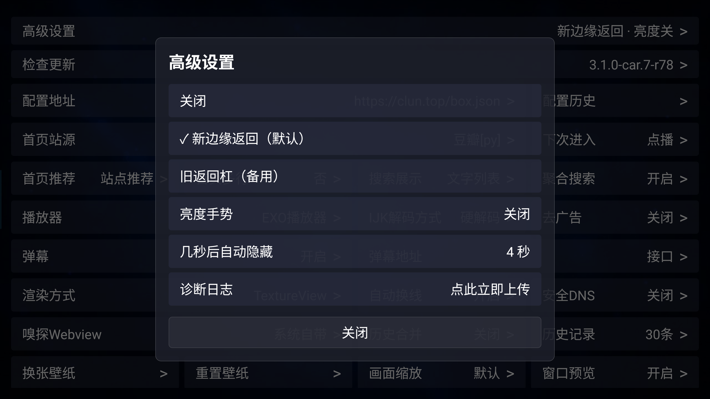
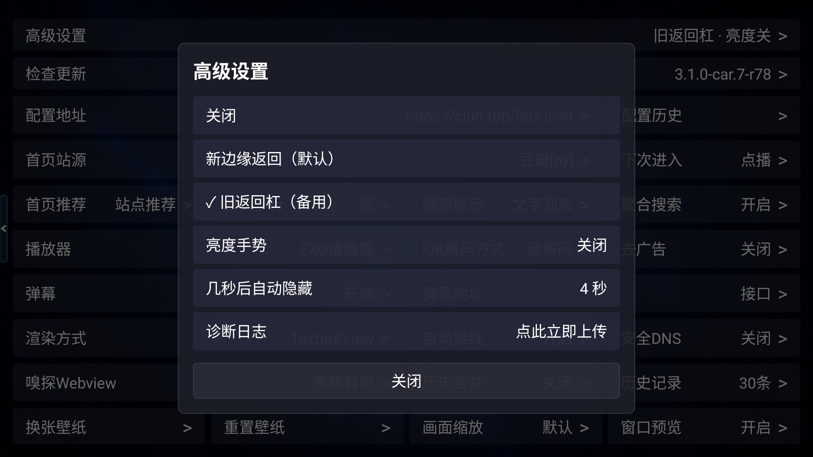
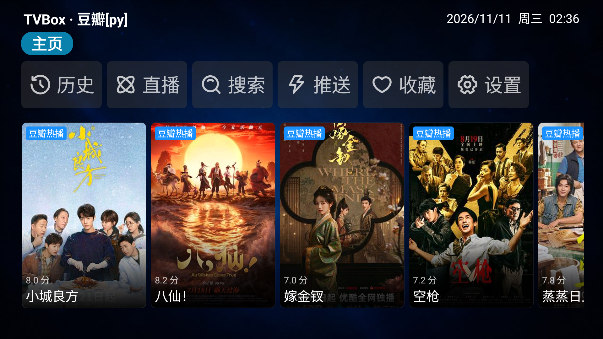
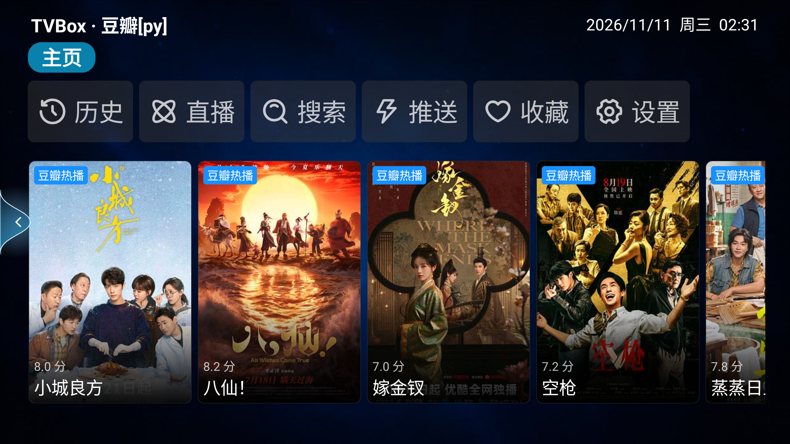
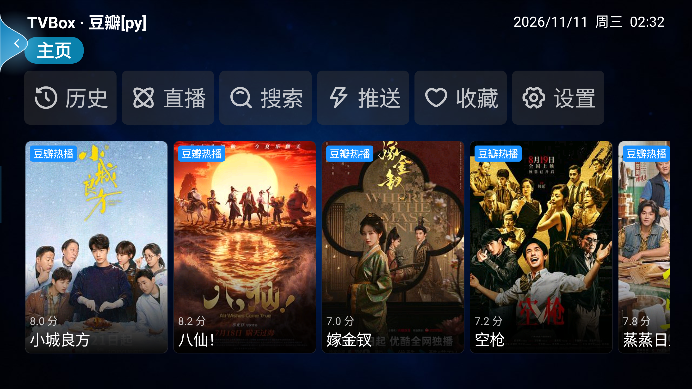
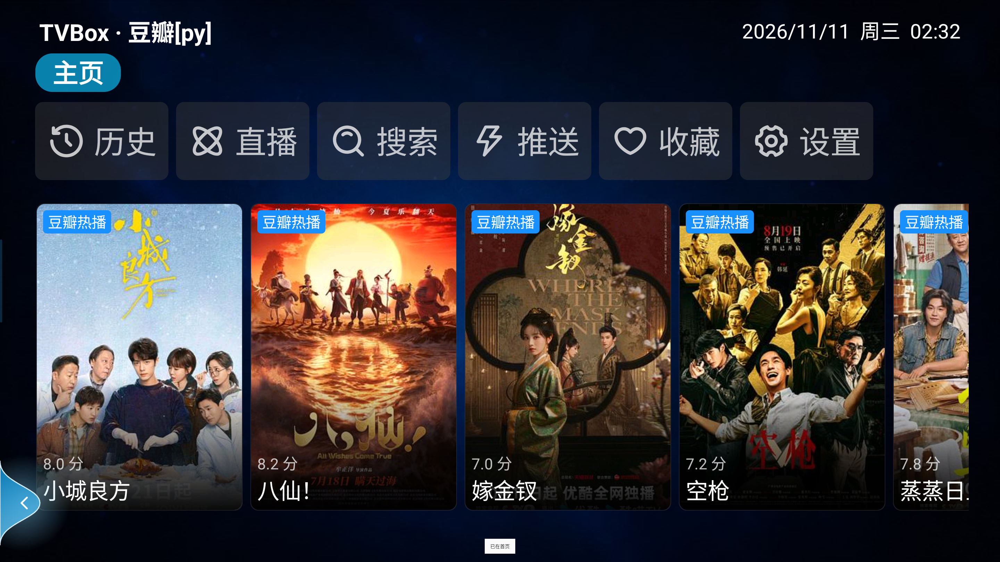
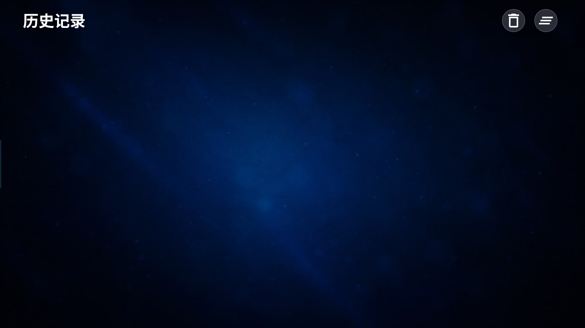
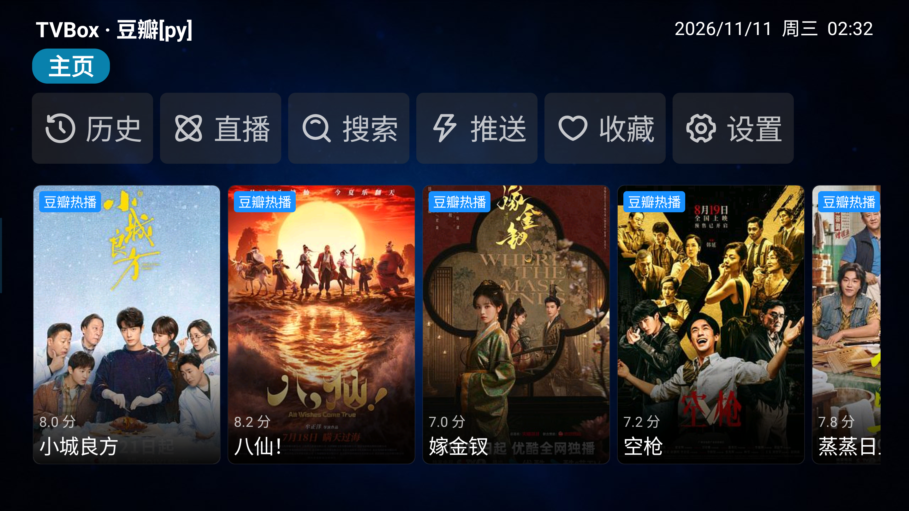
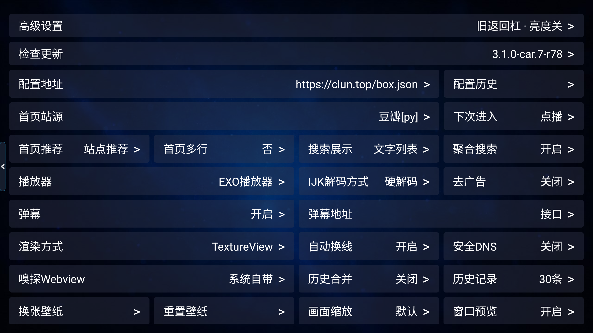

# 方案 A：新边缘返回 / 旧返回杠备用 —— 模拟车机实机带图报告

> 分支：`feature/back-redesign-a`（基于 `main` HEAD `fbbc9c12`，不污染 r77/r78）
> 候选包：`back-a-signed.apk`，SHA-256 `07A2D360D78E8DF0AAC36CEFAA4F495815BD5423A4C00A57D7487BCF74DE1139`
> 签名证书：`2FEB63C511CD725795CADC8FA890F9CBC754FE59C0BBFE0787AC33F94F44FA9C`
> 报告结论：**仅在 MuMu 模拟车机屏幕完成实现与视觉验证；未上零跑 B01 真车，未发版。**

---

## 1. 用户要求与落地结果

| 要求 | 落地 |
|---|---|
| 用方案 A | 单输入状态机 `EdgeBackPolicy` + 被动绘制 `BackAffordanceView` + DecorView 内 `InAppBackHostLayout`，无第三方库 |
| 不保留悬浮球 | 删除 `FloatingBackBallView`、`EdgePullBackView`、`EdgeSwipeBackView`、`EdgeGeometry`、`EdgeHitPolicy`；设置里不再出现悬浮球 |
| 保留旧返回杠备用 | 设置项「旧返回杠（备用）」；复刻圆角竖杠 + 小箭头，短按返回 |
| 两项设置互斥切换 | 「新边缘返回（默认）」/「旧返回杠（备用）」二选一，另保留「关闭」总开关，不算第三方案 |
| 默认视觉按车机屏幕自适应 | `BackDisplayMetrics` 按分辨率占比 + 可信密度换算毫米目标 + 占比/绝对上限双向夹取 |
| 模拟车机实机测试 + 带图报告 | MuMu 锁横屏、2880×1620 / density 160、配 `https://clun.top/box.json`，下列 12 张 PNG 与日志/像素判据 |

---

## 2. 设备与验收环境

| 项 | 实机值 |
|---|---|
| 实例池 | vm1 / `127.0.0.1:16416` / owner `back-a-20261111` |
| 分辨率 | `Override size: 2880x1620`；对照 `1920x1080` |
| Density | `Override density: 160`（真车基准）；MuMu physical density 仍报 440 |
| 横屏 | 已执行 `accelerometer_rotation=0`、`user_rotation=1`、`wm user-rotation lock 1`；后段 `settings get system user_rotation` 读回 0，但 App `geom screen=2880x1620`、PNG 尺寸 2880×1620，验收画布保持车机横屏 |
| 订阅源 | `https://clun.top/box.json`；`PyLoader: echo-getSpider url: https://clun.top/py/...` 共 14 条；首页显示 `TVBox · 豆瓣[py]` |
| pid | `12097` 稳定 |
| `FATAL EXCEPTION` | 0 |

开局截图（已配源）：


---

## 3. 设置两项互斥切换

新边缘返回默认选中：



切到旧返回杠后，勾从第一项移到第二项，二者互斥：



UI dump 原文证据：

```text
高级设置 / 关闭 / ✓ 新边缘返回（默认） / 旧返回杠（备用） / 亮度手势 / 几秒后自动隐藏 / 诊断日志
高级设置 / 关闭 / 新边缘返回（默认） / ✓ 旧返回杠（备用） / 亮度手势 / 几秒后自动隐藏 / 诊断日志
```

没有「悬浮球」「边缘滑动」「双模共存」入口。旧 `floating/swipe/both` 偏好会被 `InAppBackButton.getMode()` 归一化到 `edge`，`bar` 保留备用。

---

## 4. 默认视觉为什么不是写死像素

真车零跑 B01 原始快照：

```text
DisplayDeviceInfo{"内置屏幕": ..., 2880 x 1620, ..., density 160, 91.44 x 91.44 dpi, ...}
DisplayMode{... xDpi=91.44, yDpi=91.44 ...}
```

`91.44 dpi` 是虚拟化桩值。MuMu 在 `wm density 160` 下仍报 `xdpi=440.0 / ydpi=440.0`。如果直接拿 xdpi 换算毫米，第一轮实机日志把视觉撑到 `hit=86px / visual=230px`，仍接近用户反馈的「太大」：

```text
（修正前）geom screen=2880x1620 xdpi=440.0 ydpi=440.0 densityDpi=160 effPpi=440x440 hit=86px visual=230px ...
```

因此最终实现只有当 `xdpi/ydpi` 与 `densityDpi` 落在 `0.75–1.33` 倍时才采信为物理 PPI；否则回退逻辑密度，再用 `3%` 命中占比 / `5%` 最大视觉占比 / `96px / 160px` 绝对上限夹取。

最终 2880×1620 / density 160 的实机 `geom`：

```text
InAppBack: geom screen=2880x1620 xdpi=440.0 ydpi=440.0 densityDpi=160 dpiTrusted=false/false effPpi=160x160 estSize=457x257mm
  hit=50px(8.0mm,1.75%) visual=126px(20.0mm,4.37%) trigger=113px(18.0mm,3.94%)
  leafHalf=178px(28.3mm,11.00%) slop=13px bar=25x239px barHit=63x302px guide=6px
  mode=EDGE_GESTURE side=LEFT
```

换算表：

| 参数 | 真车基准 2880×1620 / d160 | 占屏 | 1920×1080 / d160 | 占屏 |
|---|---:|---:|---:|---:|
| 命中带 | 50px | 1.75% 宽 | 50px | 2.62% 宽 |
| 最大拉伸 | 126px | 4.37% 宽 | 96px | 5.00% 宽 |
| 返回触发 | 113px | 3.94% 宽 | 96px | 5.00% 宽 |
| 叶形半高 | 178px | 11.00% 高 | 119px | 11.00% 高 |
| 返回杠可视 | 25×239px | — | 25×238px | — |
| 返回杠点击热区 | 63×302px | — | 63×302px | — |

1920×1080 对照截图：



对照 `geom`：

```text
InAppBack: geom screen=1920x1080 ... densityDpi=160 dpiTrusted=false/false effPpi=160x160
  hit=50px(8.0mm,2.62%) visual=96px(15.2mm,5.00%) trigger=96px(15.2mm,5.00%)
  leafHalf=119px(18.9mm,11.00%) bar=25x238px ...
```

> 注：`estSize` 是回退密度推算的逻辑物理尺寸，不是真车实测屏幕毫米；报告只用它说明换算路径，不把它当作 17.3 英寸真车尺寸证据。真车屏幕物理尺寸未复核。

---

## 5. 默认边缘返回：静态、拖动、返回

### 5.1 静态细导引线


只在贴边极窄区域显示细导引线，不是悬浮球、不是半屏光带。

### 5.2 y=810 拖动中橡皮筋



保持 DOWN/MOVE 不放时抓到视觉帧；对应日志：

```text
edge_back page=HomeActivity mode=EDGE_GESTURE action=move x=120 y=810 hitPx=50
  state=DRAGGING inward=110 visual=110 velocity=1803 result=CONSUME
```

以 `10-home-edge-static.png` 为基线做像素差分，左侧 `x=0..180` 区域：

| 图 | 触点 y | 差分 x 范围 | 差分 y 范围 | 说明 |
|---|---:|---:|---:|---|
| y=810 | 810 | 0–107 | 690–929 | 视觉宽度约 108px，与 `visual=110` 接近 |
| y=180 | 180 | 0–155 | 57–301 | 叶形跟随触点，上边界没有越屏 |
| y=1450 | 1450 | 0–178 | 1327–1571 | 叶形跟随触点，下边界没有越屏 |

y=180 / y=1450 截图：





差分宽度在 y=180/1450 大于 y=810，是因为靠近上下边界时 `RadialGradient` 微光与背景对比区域更宽；代码里 `visualWidth()` 仍受 `metrics.visualPx=126px` 封顶，日志 `visual=115` 是判定依据。

### 5.3 历史页返回

历史页返回前：



在历史页从左到右拉并松手：

```text
edge_back page=HistoryActivity mode=EDGE_GESTURE action=down x=10 y=810 state=ARMED result=CONSUME
edge_back page=HistoryActivity mode=EDGE_GESTURE action=move x=125 y=810 state=DRAGGING inward=115 visual=115 velocity=2211 result=CONSUME
edge_back page=HistoryActivity mode=EDGE_GESTURE action=up x=125 y=810 state=COMMIT inward=115 visual=115 result=BACK
back_perform page=HistoryActivity mode=EDGE_GESTURE state=IDLE
mCurrentFocus=.../HomeActivity
```

返回后：



结论：历史页手势不再失效，且走的是既有 `InAppBackButton.performBack()` 导航链，没有 `activity.finish()`。

---

## 6. 备用返回杠

旧返回杠在 2880×1620 / d160 下的截图：



短按日志：

```text
edge_back page=SettingActivity mode=BACK_BAR action=down x=30 y=810 hitPx=50 state=BAR_ARMED result=CONSUME
edge_back page=SettingActivity mode=BACK_BAR action=up x=30 y=810 state=BAR_COMMIT result=BACK
back_perform page=SettingActivity mode=BACK_BAR state=IDLE
```

结论：`BAR_ARMED → BAR_COMMIT → result=BACK → back_perform` 已触发；长按、拖动、多指、CANCEL 不返回由 `BackBarPolicyHostTest` 与 `EdgeBackPolicyHostTest` 覆盖。

**如实说明**：这次短按后 `mCurrentFocus` 读到 `DetailActivity`，不是 `HomeActivity`。现有证据只能确认 `BACK_BAR` 的触发链和页面栈入口被调用；无法从这批日志判定为何落到详情页，也没有证明「短按必然回首页」。历史页的边缘返回另有 `HistoryActivity → HomeActivity` 硬证据；返回杠的具体页面栈手感需真车/用户路径复核。

---

## 7. 非命中区触摸穿透

在内容区 `x=1440 y=810` 点一下，日志：

```text
edge_back page=HomeActivity mode=EDGE_GESTURE action=down x=1440 y=810 hitPx=50
  state=IDLE inward=0 visual=0 velocity=0 result=NONE
```

`result=NONE` 表示 host 返回 `super.dispatchTouchEvent(event)`；点击后 UI 进入 `DetailActivity`，截图：


结论：该坐标在返回组件命中区之外，host 没有消费事件；内容点击仍然到达页面并进入详情。

---

## 8. 自动化测试与构建

- `git diff --check`：OK
- 方案 A 新测试：
  - `BackDisplayMetricsHostTest PASS (81 checks)`
  - `EdgeBackPolicyHostTest PASS (57 checks)`
  - `BackBarPolicyHostTest PASS (13 checks)`
- 全量 host 套件：`ALL_HOST_TESTS_PASS`
  - 含 `BackNavPolicyHostTest 740`、`AudioVolumeRoutingHostTest 4958`、`UpdateVersionHostTest 95`、`AudioFocusHelperHostTest 77` 等
- Gradle：`:app:assemblePythonRelease -x :pyramid:generatePythonReleasePythonRequirements --offline` → `BUILD SUCCESSFUL`
- APK 签名：`apksigner verify` → `Verifies`，证书 `2FEB63C5…FA9C`
- MuMu：0 `FATAL EXCEPTION`，pid 稳定，PyLoader 14 条

---

## 9. 图片清单

| 文件 | 内容 |
|---|---|
| `24-advanced-edge-selected-clean.png` | 高级设置：新边缘返回默认选中 |
| `25-advanced-bar-selected-clean.png` | 高级设置：旧返回杠备用选中 |
| `10-home-edge-static.png` | 2880×1620 默认静态细导引线 |
| `13-edge-drag-hold-120.png` | y=810 拖动中橡皮筋 |
| `14-edge-drag-y180.png` | y=180 拖动 |
| `15-edge-drag-y1450.png` | y=1450 拖动 |
| `26-back-bar-home-clean.png` | 旧返回杠视觉 |
| `16-history-before.png` | 历史页返回前 |
| `17-history-after-back.png` | 历史页返回后 |
| `18-blank-passthrough.png` | 非命中区点击穿透到详情页 |
| `07-home-source-loaded.png` | 已配订阅源首页 |
| `28-1920x1080-d160-edge.png` | 1920×1080 / density 160 对照 |

---

## 10. 未验证与下一步

1. **零跑 B01 真车未跑**：真车 `91.44dpi` 桩值、17.3 英寸物理尺寸未复核；本报告只证明「分辨率/密度自适应逻辑」在模拟车机屏幕上不写死像素、视觉占比受控。
2. **真车听感、ROM 音频、车机安装白名单**均不在本轮范围内。
3. **返回杠短按的页面栈手感**需在真车或用户实际使用路径确认；本报告只证明触发链与视觉，未把它写成必然回首页。
4. 用户确认本报告后再提交/推送 `feature/back-redesign-a`；若决定发 r79，必须同时写 `tvbox-car` + `TVBox` + GitHub Release 三处一致的 notes。
5. 批次结束会释放 MuMu lease，并把 `wm size/density` 恢复/记录，不碰 `do_not_touch` 实例。
