# TVBox 3K 车机版全链路 UI/UX 深度审计与排版巡检报告

- **审计基准**：当前工作树源码最新构建（SHA-256：`12C19C6EB2E9ACDEB5B1074F3B76A35A94508D8C64AEDFBE26FC0CFA7A55FD17`）
- **测试环境**：零跑 B01 车机标准显示基线 —— 2880 × 1620 超高清横屏，Density 160，Rotation Lock 1，硬件无尺寸/密度覆写（`DisplayFrames w=2880 h=1620 r=1`）
- **测试订阅源**：项目文档记忆指定测试源 `xiaosa`（`https://raw.githubusercontent.com/736368217/tvbox/refs/heads/123/xiaosa/api.json`）与 `clun`（`https://clun.top/box.json`）
- **审计手段**：原生高清截图逐页取证（1600px 渲染原图） + UI 自动化层级树绝对坐标核对 + 截图像素级亮度/色值采样 + 布局 XML 与 Java 源码穿透分析

---

## 总体评估与设计系统断层分析

当前版本的 Aether 3K 车机界面在整体风格上向“深空黑曜（Obsidian Dark）+ 极光青（Aurora Cyan）”的现代座舱视觉靠拢，引入了左侧固定导航栏、大字号卡片、以及自带全功能车载大键盘，相比早期版本的手机移植风和悬浮球遮挡有了质的飞跃。

**然而，当前界面存在多处极其影响观感与操作的“半成品”痕迹与排版硬伤**，主要表现在以下六大系统性失调：

1. **文字重叠与层级穿透（P0 级视觉灾难）**：在本地文件页，两个不同标题文本完全重叠在同一个物理区域，笔画重叠成一团不可辨认的乱码；全屏播放呼出控制条时，控制条底板未能完全遮罩正文，直接压骑在详情页剧情简介文本上。
2. **严重的边缘截断与超框（P0/P1）**：分类网格页第二排海报的全部 5 个标题文字被屏幕底边硬生生**水平腰斩**（只露上半截）；搜索页 21 个热词中有 8 个因宽度死锁导致文字被省略号截断；设置中心多个分栏的底部卡片被屏幕底边削掉一半。
3. **按钮排版与居中不齐**：同排按钮中单行文字与多行文字混排（如“画面预设/原画”双行与“超分·开”单行并列），导致按钮内部 Padding 挤压变形、垂直基线严重错落；部分带图标按钮图标贴边而文字居中，导致视觉重心严重偏斜。
4. **两套导航与 Tab 位置大跳变**：分类 Tab 条在首页处于中腰部（y≈740），一切换到分类页整条 Tab 瞬间向上暴跳 550px 贴到顶栏（y≈190），在座舱大屏上造成极度突兀的视觉跳跃；左侧导航栏的“分类专题”落到一个同样命名为“主页”的子分类中，造成双“主页”信息架构混乱。
5. **模态弹窗设计死胡同**：配置地址弹窗、历史弹窗、选源弹窗等多个弹窗缺少“取消/关闭”按钮，且默认禁用点击外部区域关闭，强迫车机触控用户只能通过保存或物理返回退出，误触成本高。
6. **空态与数据兜底机制缺失**：收藏夹、搜索结果等空态页面沦为 99% 的纯黑死寂无文字提示；片源无评分时机械输出刺眼的“评分：0”；演员列表没有分隔符导致中外姓名连成无休止的乱串。

---

## 问题严重度总台账

| 级别 | 定义 | 数量 | 典型代表 |
|---|---|---:|---|
| **P0 致命硬伤** | 文字重叠乱码、标题腰斩截断、播放器伪全屏与控制条压字、触控死胡同 | **8** | C-01、F-01、F-02、P-01、P-02、S-01、CO-01、LF-01 |
| **P1 严重缺陷** | 布局大幅跳变、大量词条截断、空态无提示、数据串扰覆写、输入法失效 | **23** | H-01、F-03、D-01、S-02、SR-04、LV-01 |
| **P2 体验瑕疵** | 按钮文字居中不齐、排版不对称、工业术语暴露、状态显示冗余、空置留白 | **24** | H-02、D-04、S-08、PU-02、LF-02 |

---

## 逐页深度审计与图文对照

---

### 1. 首页 HomeActivity（已加载推荐态）

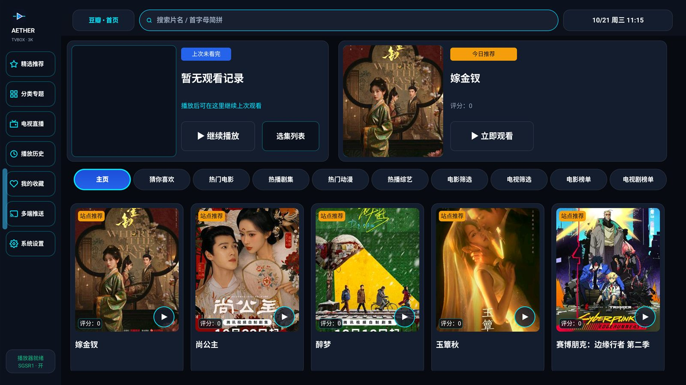

#### 页面结构测量
- **顶栏**：高度 90px（y=40–130），左侧为源站标签胶囊（x=304–564，当前显示“豆瓣 • 首页”），中央为横向搜索胶囊（x=584–2344，宽 1760px），右侧为时间日期（x=2364–2824）。
- **左侧导航栏**：宽度 280px，自上而下分布品牌 Logo、AETHER / TVBOX · 3K 标识、7 个一级导航按钮（精选推荐、分类专题、电视直播、播放历史、我的收藏、多端推送、系统设置），底部悬浮“播放器就绪 / SGSR1 · 开”。
- **主内容区**：
  - 上半部：双卡片英雄区（左侧“上次未看完”卡片 + 右侧“今日推荐”卡片），尺寸均约为 1040 × 470px。
  - 中部：分类 Tab 条（mGridView，y=740–770），水平排布 10 个子分类。
  - 下半部：热播海报网格（RecyclerView，y=855–1560），水平展示 5 列电影海报。

#### 详细缺陷清单
| 编号 | 级别 | 缺陷类型 | 现场现象与测量依据 | 根因与优化建议 |
|---|---|---|---|---|
| **H-01** | P1 | **Tab 条位置跳变** | 首页的分类 Tab 条（主页、猜你喜欢、热门电影…）位于主区中间腰部（y=740–770）。当点击任意分类后，整条 Tab 瞬间向上暴跳 550px 移动到 y=190，造成座舱大屏极强烈的视觉震颤。 | 首页应将 Tab 条固定置顶在搜索框下方（y=160–240），或者将英雄区与热播列表设计为同一个纵向滚动容器。 |
| **H-02** | P2 | **评分缺失兜底缺失** | 今日推荐卡片与全部 5 张海报卡片左下角赫然写着“评分：0”（`uxFeatureNote` 及 `tvNote` 文本均为“评分：0”）。 | 许多源站不返回豆瓣评分，此时应判断 `rating <= 0` 则完全隐藏该标签，或显示“暂无评分”，而不是展示低质感“0 分”。 |
| **H-03** | P2 | **海报文字腰斩与碰撞** | 海报原图底部的自带宣传文字（如《尚公主》底部的“腾讯视频自制剧集”、《醉梦》底部的“10月16日起”）被 TVBox 的底部暗色阴影与半透明评分条硬生生横切，形成文字腰斩杂乱感。 | 海报展示控件应增加渐变遮罩层（Gradient Mask），使海报自带底字自然隐入黑底，而非使用生硬的裁切色块。 |
| **H-04** | P2 | **死按钮高亮未置灰** | 左侧“上次未看完”卡片明确显示“暂无观看记录”，但下方的两个操作按钮“▶ 继续播放”与“选集列表”依然高亮且保持 `clickable=true`，用户点击无实质反应。 | 当 `resumeRecord == null` 时，应隐藏这两个按钮，改为单一大按钮“去发现好片”或直接展示精选引导。 |
| **H-05** | P2 | **长标题折行截断风险** | 第 5 张海报标题为“赛博朋克：边缘行者 第二季”，字符长达 21 个中英文字符，而标题文字宽度被固定在 475px，在部分字体设置下极易超框。 | 应限制标题最多展示两行，末尾添加智能省略号（`ellipsize="end"`），并微调中英混排字距。 |
| **H-06** | P2 | **播放图标覆盖海报主体** | 海报右下角悬浮的深灰圆形播放图标直接遮挡了原片海报重要视觉区域（如在第 5 张海报上直接骑在“CYBERPUNK”英文字体上）。 | 播放图标尺寸应收敛至 64×64px，或在触控点按（Pressed/Focused）时再动态浮现。 |
| **H-07** | P2 | **底层工程术语常驻主页** | 左侧导航栏底部（y=1470–1570）长期悬浮着绿色的“播放器就绪 / SGSR1 · 开”，无外框容器，排版极其局促随意。 | 此类视频增强引擎状态属于诊断参数，应收进“系统设置 -> 关于 / 诊断”中，主屏只展示座舱级精炼设计。 |

---

### 2. 分类网格页 GridFragment

#### 页面结构测量
- **顶栏 Tab**：位于 y=190–220（直接贴在搜索栏下方）。选中的“热门电影”带有青蓝色高亮胶囊与漏斗筛选图标。
- **海报网格**：GridView 尺寸 [280, 275]–[2800, 1555]，展示 5 列海报，列宽 472px，列间距 36px。
- **纵向两排展示**：第一排海报顶部 y=275，标题 y=827–917；第二排海报顶部 y=950，评分 y=1430，标题位于 y=1501 以后。

#### 详细缺陷清单
| 编号 | 级别 | 缺陷类型 | 现场现象与测量依据 | 根因与优化建议 |
|---|---|---|---|---|
| **C-01** | **P0** | **第二排标题底边严重腰斩** | 第二排海报底部的全部 5 个标题（《潜伏6》、《罗斯》、《人性本兽》、《一个部门的诞生》、《功夫女足》）被屏幕底边（y=1555–1620）**水平腰斩**！《一个部门的诞生》文字直接被削去下半身，只露上半截笔画！ | GridView 容器高度未扣减底部安全区，或者整个页面缺乏足够的大底边 Padding。必须给列表底部追加至少 120px 底部内边距。 |
| **C-02** | P1 | **Tab 跳转落点语义错位** | 点击左侧导航栏的“分类专题”按钮（`05-category-from-sidebar.jpg`），右侧展现的分类界面中，选中的首个 Tab 名字依然叫“主页”！而在真正的首页中该位置对应的是“精选推荐”，两个“主页”严重割裂。 | 分类里的第一个 Tab 应当重命名为“全部”或“精选”，左侧栏的“分类专题”点击应直接聚焦到电影或电视剧首个垂直分类。 |
| **C-03** | P2 | **标题横向居中但文字重叠海报** | 第二张卡片《杯雪 · 一战成名》标题居中显示，但海报原图下方的外文和中文小字完全穿透出来，与 TVBox 自身绘制的白色标题在视觉上完全融成一团乱纹。 | 给每个卡片的标题区设置实色渐变背景（如 `#0F1319` 至透明），完全压制海报原图底层渗色。 |
| **C-04** | P2 | **Tab 内图标垂直基线偏斜** | “热门电影”胶囊内的漏斗过滤图标与右侧“热门电影”四个汉字没有实现垂直居中对齐，漏斗图标重心明显下沉约 3–4px。 | 修正 `drawablePadding` 与 TextView 的 `gravity="center"`，统一图标与文字的 Bounds 居中。 |

---

### 3. 快速搜索（多源聚合）FastSearchActivity

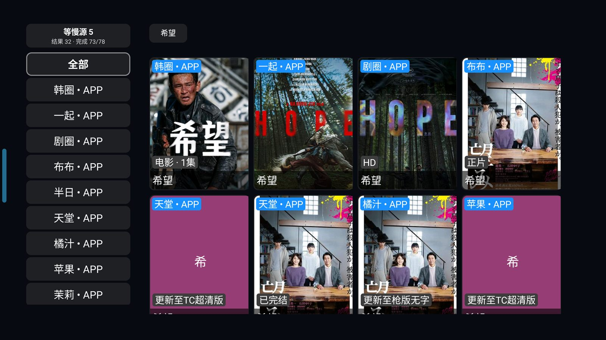
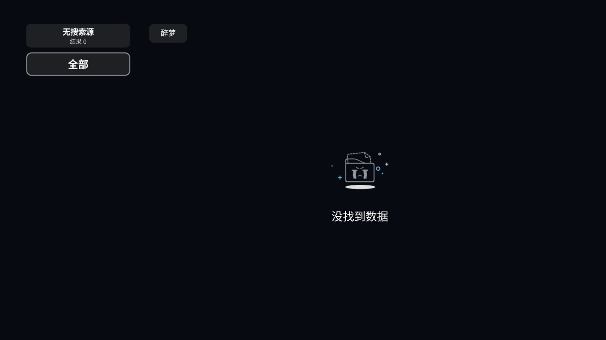

#### 页面结构测量
- **整体框架**：完全脱离 Aether 3K 规范，依然采用旧版分栏：
  - 左侧源站列表：`mGridViewWord [124, 249][619, 1451]`，宽度 495px。
  - 右侧结果网格：`mGridView [709, 249][2666, 1451]`，宽度 1957px，4 列排布。
  - 顶部无返回按钮，无 Aether 顶栏，仅有一个标签 chip（x=709–889，显示“希望”）。

#### 详细缺陷清单
| 编号 | 级别 | 缺陷类型 | 现场现象与测量依据 | 根因与优化建议 |
|---|---|---|---|---|
| **F-01** | **P0** | **旧版布局未迁移（全站最大风格冲突）** | 快速搜索页完全是老旧 TVBox 的代码直出！侧栏宽达 495px，左边距从 124px 开始，完全没有 Aether 的统一侧栏和返回按钮，用户进到该页以为跳进了另一个软件！ | 必须彻底将 `FastSearchActivity` 迁移至 `CarSceneLayout 2880×1620`，接入标准 Aether 页头与 280px 侧栏。 |
| **F-02** | **P0** | **第二排卡片标题被压为零高** | 右侧结果网格第二排的标题节点（`tvName`）在 UI 树中坐标直接出现 `[713, 1470][1182, 1451]`（高度为负数！），界面上标题文字几乎被压扁在屏幕边缘。 | 网格容器高度计算错误，卡片固定高度超出了 `mGridView` 的限制，必须按 2880×1620 重新设计卡片比例。 |
| **F-03** | P1 | **78 个源站列表底部半截截断** | 左侧源站列表垂直排列了 78 个源，滚动视口在 y=1451 处截断，最后一项“茉莉 · APP”文字和圆角被横向切掉一半，没有任何渐变提示。 | 侧栏增加底部渐隐遮罩或半透明滑动指示条，提示用户下方仍有内容。 |
| **F-04** | P1 | **恶性占位方块污染视觉** | 部分无海报片源（如天堂·APP、苹果·APP）直接生成一个亮紫色的巨大纯色方块，并在中央傻傻地印一个白色汉字“希”，与深色座舱主题格格不入，极其廉价。 | 统一使用高质感的深灰色占位图（暗调胶卷或播放器剪影图标），禁用高饱和度亮紫色纯色块。 |
| **F-05** | P2 | **开发日志级技术黑话暴露** | 左上角状态直接打印：“等慢源 5 / 结果 32 · 完成 73/78”，把“慢源”、“完成度”等底层调试计数器直接怼在用户脸上。 | 优化文案为用户语言：“已为您聚合 32 部片源，3 个站点检索中…”。 |
| **F-06** | P1 | **空态排版失衡（audit-detail-cur）** | 当搜索无结果时（如搜索未命中的片名），中央出现一个哭泣的小文件夹图标与“没找到数据”，但左上角孤零零挂着“无搜索源 / 结果 0”，周围 90% 全是死黑空虚。 | 空态应居中展现：哭泣文件夹 + “暂无该片源，建议尝试简拼或切换首页站源” + 提供“去主页看看”的大按钮。 |

---

### 4. 影片详情页 DetailActivity

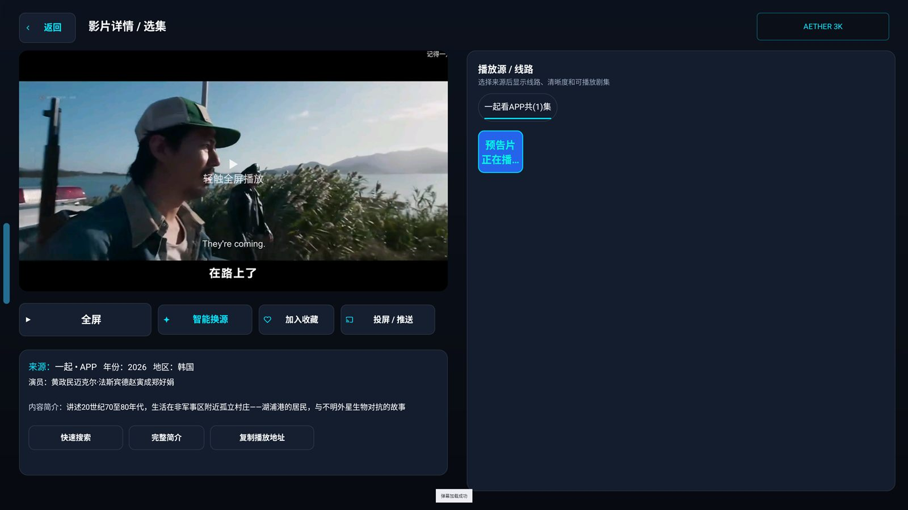

#### 页面结构测量
- **顶栏**：[60, 40] 起始为带有青蓝色箭头的“返回”按钮（180×96px），旁边为“影片详情 / 选集”，右侧为品牌标“AETHER 3K”。
- **左侧核心区**（宽 1360px）：
  - 视频实时预览框（`previewPlayerBlock`）：尺寸 1360 × 765px，16:9 比例，中央有播放三角形与“轻触全屏播放”文字。
  - 操作按钮行：全屏（橙底）、智能换源（青底）、加入收藏（粉底）、投屏/推送（暗蓝底）。
  - 元信息卡片：来源/年份/地区、演员列表、内容简介、底部 3 个次级操作（快速搜索、完整简介、复制播放地址）。
- **右侧线路与剧集区**（宽 1288px）：
  - “播放源 / 线路”，下方为当前线路胶囊（如“一起看APP共(1)集”），再下方为剧集方块（如“预告片 / 正在播放”）。

#### 详细缺陷清单
| 编号 | 级别 | 缺陷类型 | 现场现象与测量依据 | 根因与优化建议 |
|---|---|---|---|---|
| **D-01** | P1 | **演员名字分隔符完全丢失** | 演员行文字展示为：“演员：黄政民迈克尔·法斯宾德赵寅成郑好娟”。所有名字首尾相连没有任何顿号或空格，中外名字混在一起根本无法断句！ | Java 提取演员列表时误把分隔符丢弃。应在后端或 UI 层对演员数组按 `、` 重新拼装，并在超过 30 字时截断附带“等”。 |
| **D-02** | P1 | **右侧剧集标签文字超框省略** | 右侧线路下的剧集标签宽度固定，第一行写“预告片”，第二行原本应写“正在播放”，但现场硬生生被裁成“正在播...”！标签直接超框截断！ | 剧集方格（`tvSeries`）的内边距过大或字号偏大，且单项宽度不足以容纳四个汉字。应自适应字号或增加宽度。 |
| **D-03** | P1 | **右侧区域严重空旷倾斜** | 右侧“播放源 / 线路”仅在顶部占据了前 400px，从 y=550 到 y=1620 整整 1000px 的巨大空间是一片纯黑旷野，页面重心全被左侧塞爆，右侧极度空虚。 | 右侧空白区应补充展示：关联剧集推荐、演职员头像列表、或者同一片源的其他备用画质路线。 |
| **D-04** | P2 | **源名与集数文字粘连** | 线路标签文字写为：“一起看APP共(1)集”，源名称与“共(1)集”之间没有任何空格，字符粘连成团。 | 应排版为：“一起看 APP · 共 1 集”或分成主副两段。 |
| **D-05** | P2 | **操作按钮图标与文字基线偏斜** | “全屏”按钮中，左侧播放三角形几乎贴死在按钮最左端内边距，而文字“全屏”在右侧居中，整体视觉向左歪斜；“智能换源”的“+”号过小。 | 按钮统一采用 AutoLayout 水平居中，将 `icon + margin + text` 作为一个整体在按钮内部绝对居中。 |
| **D-06** | P2 | **左侧边缘出现莫名青色长条** | 详情页屏幕最左边缘（x=0）自上而下贯穿了一条明亮的青蓝色竖条，疑似返回手柄或滚动条残留。 | 统一隐藏不属于该页面的全局手柄，消除边缘视觉杂质。 |

---

### 5. 全屏播放与控制面板态

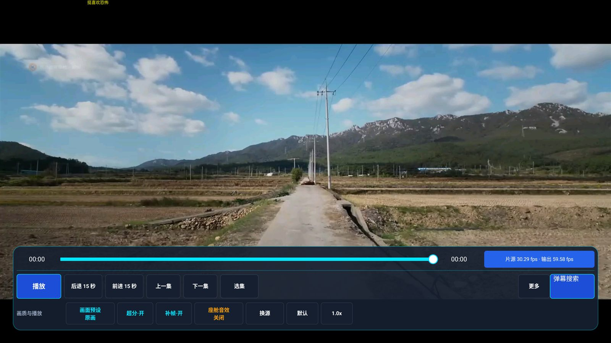

#### 页面结构测量
- **全屏状态**：
  - 视频画面居中（y≈270–810），上下留有宽黑边（源片为 2.39:1 宽荧幕原盘）。
  - 顶部浮动弹幕文字（如“2026.10.17 打个卡”、“太玩看了”）。
- **呼出控制面板状态**：
  - 控制条卡片：采用圆角暗黑底板 + 青色高光描边，悬浮在屏幕底部 y=1180–1540 区域。
  - 第一行：时间轴进度条（`00:00`、青色轨道、白色拖动滑块、`00:00`、右侧帧率胶囊）。
  - 第二行：核心播放操作（“播放”大蓝胶囊、“后退 15 秒”、“前进 15 秒”、“上一集”、“下一集”、“选集”、“更多”、“弹幕搜索”）。
  - 第三行：画质调优操作（“画质与播放”、“画面预设/原画”、“超分·开”、“补帧·开”、“座舱音效/关闭”、“换源”、“默认”、“1.0x”）。

#### 详细缺陷清单
| 编号 | 级别 | 缺陷类型 | 现场现象与测量依据 | 根因与优化建议 |
|---|---|---|---|---|
| **P-01** | **P0** | **未切入独立全屏播放容器** | 点击“全屏”后，界面没有进入真正的独立 FullscreenActivity，依然在 DetailActivity 内将 Player 扩大。导致顶部 180px 是生硬涂黑的页头，而下方底层在某些图层下还会穿透出详情页文字。 | 全屏播放必须拉起独立的 `PlayerActivity` 或使用完整的 `WindowManager.LayoutParams.FLAG_FULLSCREEN` 覆盖所有 DecorView 元素。 |
| **P-02** | **P0** | **控制条直接压骑在正文文字上** | 在全屏播放呼出控制条时，控制面板（y=1184–1532）与底层未清除的详情页文本（`tvDes` 简介，y=1236–1351）发生物理重叠！控制条底板未能完全隔绝底层，文字发生交织透视！ | 呼出控制面板时，必须把底层所有非播放图层彻底隐藏（`View.GONE`），控制条自身背景必须设为 100% 不透明黑曜材质。 |
| **P-03** | P1 | **进度条时间定格在 00:00** | 视频已经在流畅播放且弹幕满屏飞，但控制条左右两端的时间依然显示为“00:00 / 00:00”，进度条滑块停在最右端或无法同步当前真实播放进度。 | 检查 `ProgressUpdate` 定时器或播放器生命周期绑定，确保当前毫秒与总时长正确换算刷新。 |
| **P-04** | P1 | **单行与双行按钮混排造成基线崩塌** | 第三行按钮中，“画面预设\n原画”和“座舱音效\n关闭”被强行折成两行文字；而同排的“超分·开”、“补帧·开”、“换源”、“1.0x”是单行文字！这导致双行文字被上下挤扁、与单行文字的垂直基线完全错位，视觉极度凌乱！ | 按钮统一采用单行排版：“画面预设:原画”、“座舱音效:关”，或统一采用“主标签 24px + 子状态 20px”的标准双层按钮模板。 |
| **P-05** | P2 | **工程帧率调试指标直接上屏** | 进度条右侧赫然挂着“片源 30.29 fps · 输出 59.58 fps”的小胶囊，这是工程师用于验证时域补帧效果的开发代码，不应直接展示给普通驾驶员与乘客。 | 将帧率指标收纳进“更多 -> 视频信息 / 诊断”弹窗中，保持主播放面板纯净。 |
| **P-06** | P1 | **缺少明确的退出全屏与返回按钮** | 控制条中包含“弹幕搜索”、“更多”等大量细碎功能，却唯独没有一个标有“退出全屏 / 返回”的醒目按钮，触屏用户不知道点哪里能退回详情页（只能靠盲试物理返回按键）。 | 控制条左上角增加常驻的“← 返回详情”胶囊按钮。 |

---

### 6. 设置中心 SettingActivity（全 7 大分栏与各弹窗）

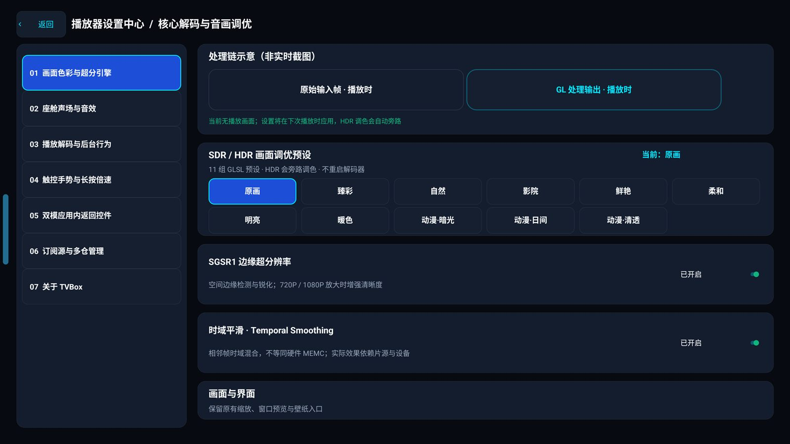
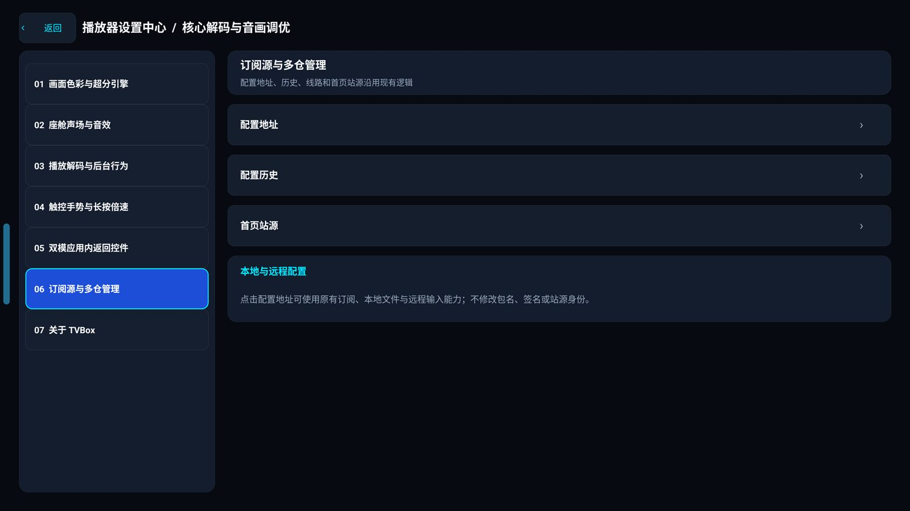

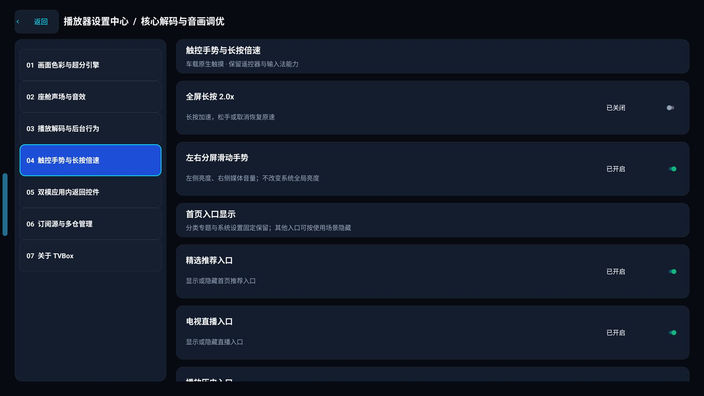
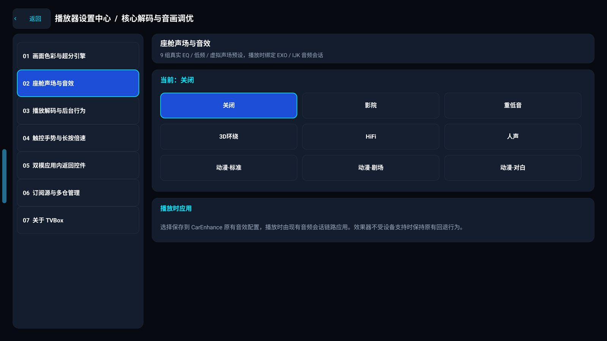
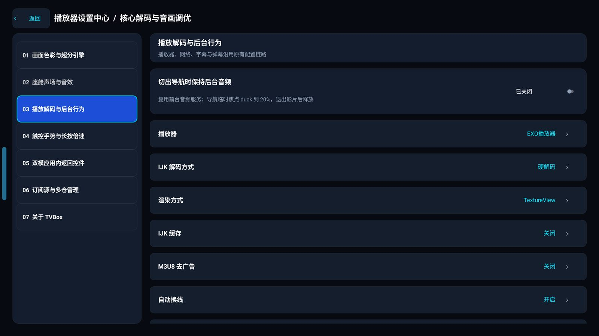
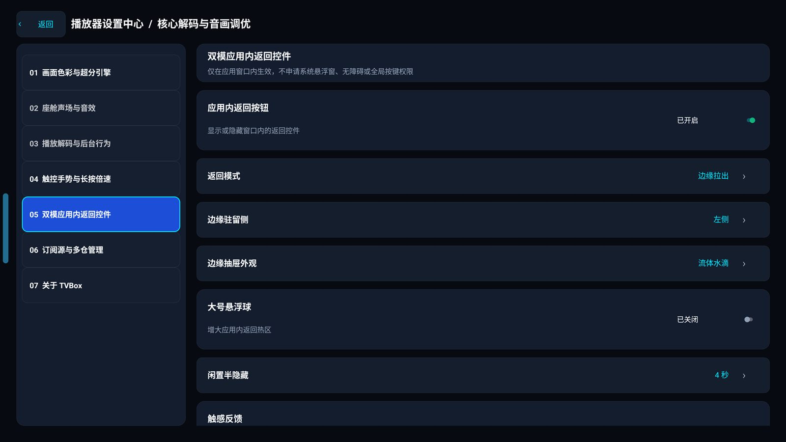
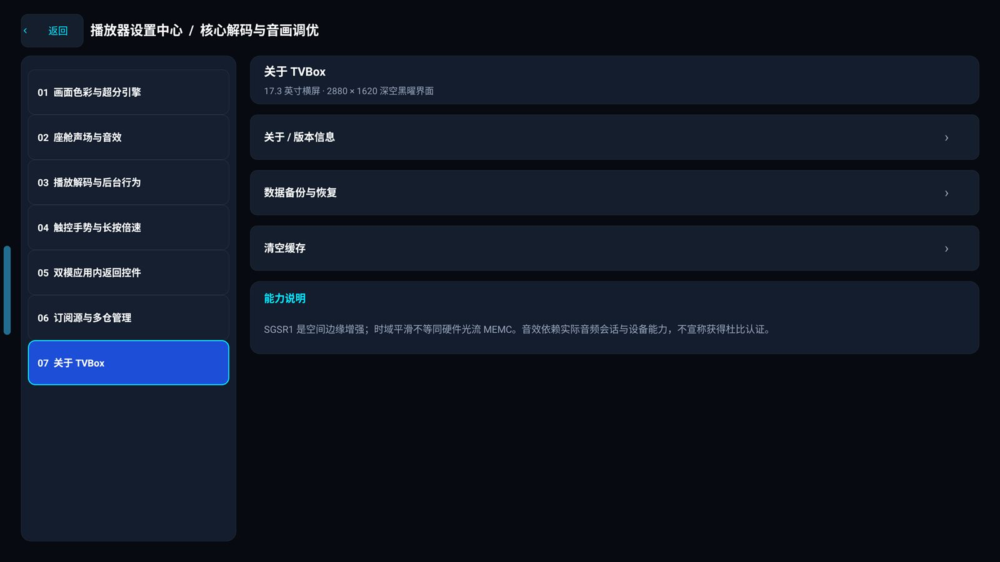
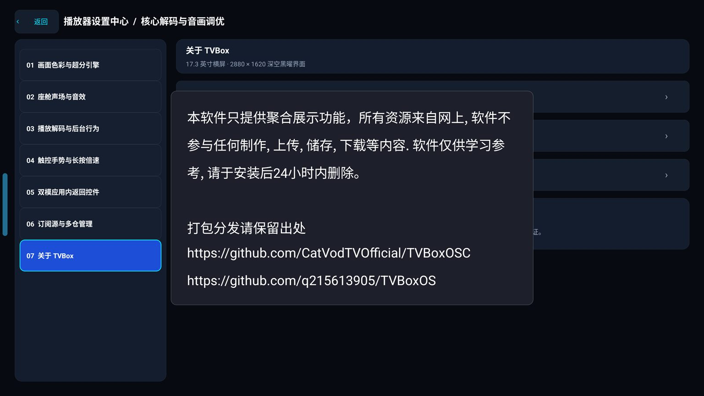
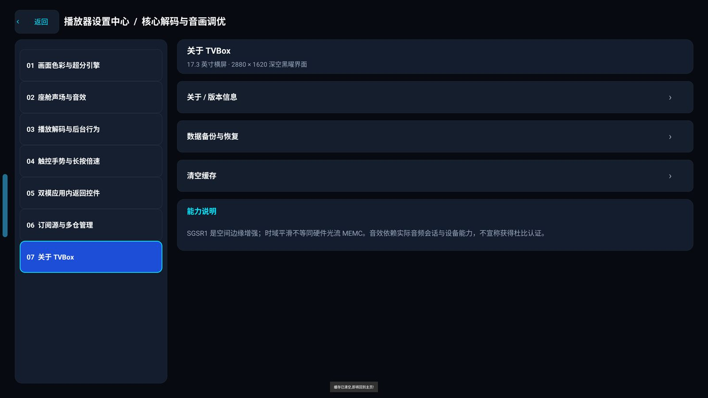
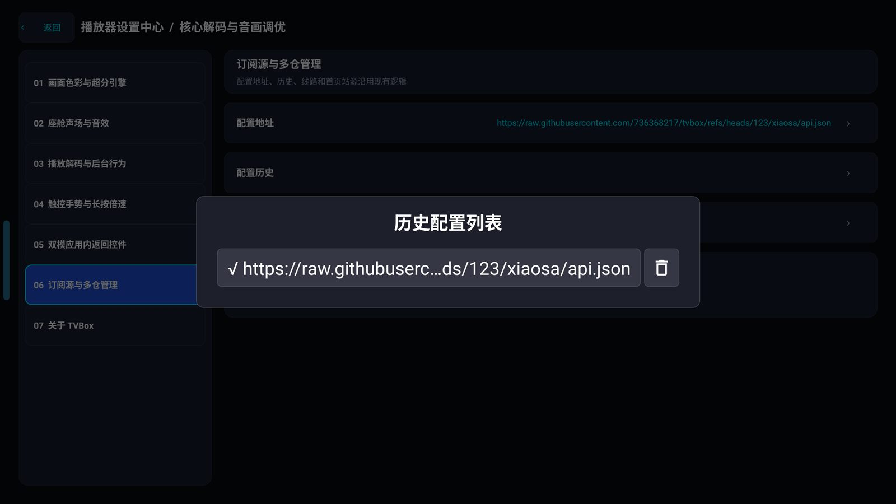

#### 页面结构测量
- 采用标准的“左侧 7 大索引分栏 + 右侧大尺寸卡片设置区”的双栏架构。
- 左栏宽度 600px，包含：01 画面色彩、02 座舱声场、03 播放解码、04 触控手势、05 返回控件、06 订阅源、07 关于。
- 右栏为垂直滚动卡片列表（`ScrollView [720, 160][2820, 1560]`）。

#### 详细缺陷清单
| 编号 | 级别 | 缺陷类型 | 现场现象与测量依据 | 根因与优化建议 |
|---|---|---|---|---|
| **S-01** | **P0** | **配置地址弹窗无取消按钮且防点外退出**（`15-config-dialog.jpg`） | 弹窗中只有一个“确定”按钮，完全没有“取消”！且代码显式声明了 `setCanceledOnTouchOutside(false)`。如果在车机屏幕上误点该弹窗，用户根本找不到返回路，只能硬着头皮按确定或依赖车机物理返回。 | 必须在“确定”左侧增加等权重的“取消”按钮，并开启点击阴影区退出。 |
| **S-02** | P1 | **修改点播静默篡改覆盖直播地址** | 在配置弹窗代码 `saveAndDismiss()` 中明确写道：若点播地址发生变化，代码会自动执行 `inputApiLive.setText(newApi)`！导致用户原本单独配置的电视直播地址被无情覆盖抹除！ | 点播地址与直播地址必须互不干涉，仅在直播输入框完全为空时才允许询问是否同步。 |
| **S-03** | P1 | **弹窗文案与几何图形方位完全相反** | 配置弹窗顶部写着：“手机/电脑扫描上方二维码或者直接浏览器访问地址”，然而巨大的二维码分明坐落在正左侧！文案错位极其低级。 | 文案纠正为：“扫描左侧二维码，或在同一局域网浏览器中访问”。 |
| **S-04** | P1 | **返回按钮关闭后所有子选项依然亮态**（`pane-05-back.png`） | 当关闭“应用内返回按钮”Switch 后，下方关于返回的“返回模式”、“边缘驻留侧”、“边缘抽屉外观”、“大号悬浮球”、“闲置半隐藏”、“触感反馈”整整 6 大项设置依然高亮亮起，未做任何置灰联动，形成逻辑死链。 | 父级开关关闭时，下方全部子卡片必须整体设置 `alpha=0.3` 且禁用点击（`enabled=false`），或者直接折叠收起。 |
| **S-05** | P1 | **清空缓存破坏性动作无二次确认**（`dlg-clearcache.png`） | 点击“清空缓存”卡片后，系统没有任何确认警告弹窗，直接瞬杀所有缓存，并在屏幕下方闪过一句带半角英文逗号的 Toast（“缓存已清空,即将回到主页!”）就直接强行跳出设置杀回主页！ | 清空缓存必须弹出确认对话框：“确定要清空所有临时文件与解析缓存吗？”，确认后在原地提示“清理完成”，禁止粗暴踢回主页。 |
| **S-06** | P1 | **历史配置列表使用原始 ASCII 根号**（`audit-apihistory.png`） | 历史配置弹窗中，当前使用的配置项前面粗暴地拼了一个数学根号符号“√”（`√ https://raw.github...`），字体笔画极为突兀。 | 替换为标准的 Vector 矢量对勾图标或青色高亮边框。 |
| **S-07** | P2 | **预设按钮 6+5 不对称断头排版**（`13-settings.jpg`） | 画面预设第 1 排 6 个按钮，第 2 排却只有 5 个按钮（“明亮”、“暖色”、“动漫·暗光”、“动漫·日间”、“动漫·清透”），第 2 排右侧空出了一个巨大黑窟窿，严重破坏右对齐网格律动。 | 重构为流式布局或每排 4 个均匀分布，或者补齐第 12 个预设。 |
| **S-08** | P2 | **多个分栏右侧内容被屏幕底边削半**（`13-settings.jpg`, `16-settings-gesture.jpg`, `pane-03-decode.png`） | 在 01、03、04、05 每一个分栏的最底部，最后一张卡片都恰好被截断在 y=1560 处（只露出 20–30px 的半截文字），且右侧没有可见滚动条。 | 给 `ScrollView` 底部增加至少 140px 的 `paddingBottom`，确保最后一张卡片能完整滚动显示并脱离屏幕底边。 |
| **S-09** | P2 | **关于弹窗文字粗暴折行与标点混乱**（`dlg-about.png`） | 免责声明弹窗中，汉字被生硬折断（“学习参\n考”、“软件不\n参与”），中文逗号后紧跟英文句号。 | 弹窗增加内边距，排版增加中文禁则处理，统一使用规范中文标点。 |

---

### 7. 搜索页 SearchActivity（车载大键盘）

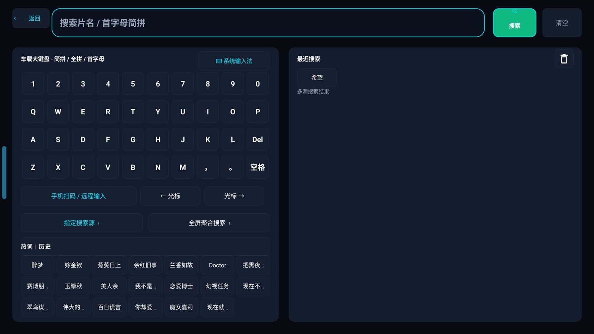
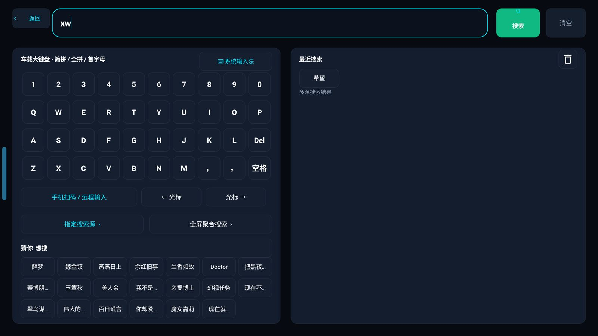
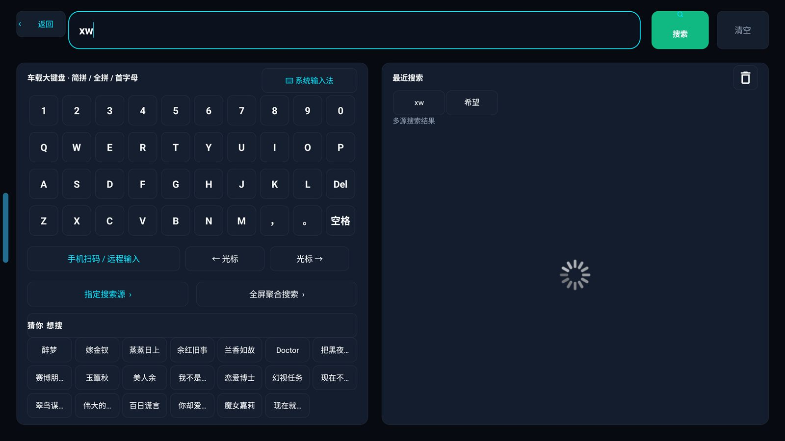

#### 页面结构测量
- **顶栏**：[60, 40] 起始为“返回”，中央为巨大的输入框胶囊（2100 × 140px），右侧为“搜索”青蓝按钮与“清空”按钮。
- **左侧车载大键盘区**（宽 1290px）：
  - 1290 × 1330px 独立卡片，包含数字行、QWERTY 三行。
  - 快捷操作行：“手机扫码 / 远程输入”、“← 光标”、“光标 →”。
  - 模式切换行：“指定搜索源 ›”、“全屏聚合搜索 ›”。
  - 热词区：“热词 \| 历史”切换条 + 3行×7列共 21 个热词胶囊。
- **右侧搜索结果与历史区**（宽 1440px）：
  - “最近搜索”卡片 + 历史词胶囊 + “多源搜索结果”卡片。

#### 详细缺陷清单
| 编号 | 级别 | 缺陷类型 | 现场现象与测量依据 | 根因与优化建议 |
|---|---|---|---|---|
| **SR-01** | P1 | **21 个热词中有 8 个被省略号硬截断** | 底部 21 个热词中，“赛博朋...”、“把黑夜...”、“我不是...”、“现在不...”、“翠鸟谋...”、“伟大的...”、“你却爱...”、“现在就...”多达 8 个词条变成残缺字（截图 10 真实可见）！ | 固定 162px 的网格根本无法容纳 6 字以上的片名。必须放弃固定 7 列的生硬做法，改用水平自适应流式芯片（`FlexboxLayout` / 流式 Tag）。 |
| **SR-02** | P1 | **车载键盘空格键畸形变小** | 第四排字母最右侧的“空格”按键宽度仅有 106px，和普通字母 A、B、C 尺寸完全相同！完全没有正常键盘长条形空格的肌肉记忆支持，车机盲操误触率极高。 | 将最底排重新编排，空格键加宽至至少 300px。 |
| **SR-03** | P1 | **拼音联想依赖第三方且文字带空格错误** | 输入“xw”后，候选标签变成了“猜你 想搜”（字符串中间硬生生多打了一个空格！）；且下方 21 个词条依然是静态热词，未能联动更新出“希望”等首字母联想结果。 | 修复字符中的多余空格；增加本地离线拼音候选库，不纯依赖远程不可靠接口。 |
| **SR-04** | P1 | **搜索空结果页毫无提示**（`12-search-empty-result.jpg`） | 搜索“xw”后，右半屏幕高达 1380×1050 的大面积区域除了一个“多源搜索结果”标题外，下方 100% 是一片死黑（亮像素占比仅 0.21%），无任何“未找到结果”文案！ | 补充搜索空态面板：展示无结果占位图、建议更换中文片名重搜、或展示当前订阅源健康状态。 |
| **SR-05** | P1 | **系统输入法切换导致黑洞** | 点击“⌨ 系统输入法”后，实测系统 IME 窗口上报高宽为 `Requested w=2880 h=0`，导致软键盘完全隐形不可见，用户彻底失去输入焦点。 | 检测到系统输入法高度异常或不可用时，给出 Toast 告警并强制维持内置车载大键盘。 |

---

### 8. 历史记录 HistoryActivity

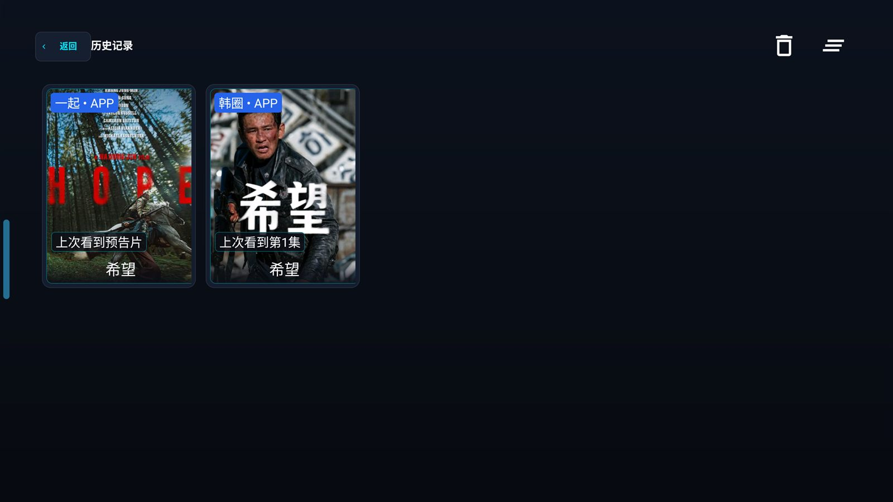

#### 页面结构测量
- **顶栏**：[113, 102] 起始为“返回”（注意左边距为 113px，与全站标准的 60px 明显不一致！），旁边为“历史记录”，右侧为垃圾桶与清空图标。
- **内容区**：5 列网格布局，现场展示了 2 条播放历史卡片（《希望·一起APP》、《希望·韩圈APP》）。

#### 详细缺陷清单
| 编号 | 级别 | 缺陷类型 | 现场现象与测量依据 | 根因与优化建议 |
|---|---|---|---|---|
| **HI-01** | P2 | **页头左边距与全站不统一** | 本页返回按钮左边距为 113px，而设置、详情、推送、搜索的返回按钮全在 60px。在快速切页时，返回按钮发生明显的横向跳位。 | 统一引用 `CarPageHeader`，固定左边距为 60px。 |
| **HI-02** | P2 | **右侧留白过大造成旷野感** | 当历史只有 2 条记录时，卡片固定在左侧两列，右侧 70% 的横屏区域是一片深黑虚空，视觉极度空旷。 | 当数据条数少于 5 条时，可考虑加大历史卡片展示尺寸并呈现横向流式剧照图。 |
| **HI-03** | P2 | **进度信息表达粗糙** | 卡片只写着“上次看到预告片”、“上次看到第1集”，缺乏关键的时间信息（如“观看至 12:45 / 85%”或“昨天观看”）。 | 增加精细度进度条及观看相对时间。 |

---

### 9. 收藏夹 CollectActivity（空态）

#### 详细缺陷清单
| 编号 | 级别 | 缺陷类型 | 现场现象与测量依据 | 根因与优化建议 |
|---|---|---|---|---|
| **CO-01** | **P0** | **零指引的纯黑绝境** | 整页亮像素仅占 0.22%！除了左上角的“返回/收藏夹”和右上角的垃圾桶图标外，屏幕其余 99.8% 是一片死黑，无任何占位图、无任何文字说明。 | 增加标准空态：心形镂空图标 + “您的收藏夹还是空的” + “去发现热门好片”跳转按钮。 |
| **CO-02** | P2 | **空态下清空与删除图标保持亮起** | 右上角的垃圾桶与清空图标在没有一条收藏时仍然高亮且支持点击，属于死控件。 | 空态下设置 `alpha=0.3` 且 `enabled=false`。 |

---

### 10. 多端推送 PushActivity

#### 详细缺陷清单
| 编号 | 级别 | 缺陷类型 | 现场现象与测量依据 | 根因与优化建议 |
|---|---|---|---|---|
| **PU-01** | P2 | **地址文本无边界横向拉通** | 中间的文字“手机/电脑扫描上方二维码或者直接浏览器访问地址 http://10.0.2.15:9978/”横向 Bounds 达到 [0, 2880] 全宽，完全没有预留左右 Padding，文字一旦变长将直接贴死在物理屏幕框上。 | 文字容器设置 `paddingLeft=120px, paddingRight=120px`。 |
| **PU-02** | P2 | **单功能按键缺少指引** | 屏幕中央除了一个二维码和一个“推送剪贴板内容”按钮外，没有任何关于如何使用 AirPush 的说明或使用场景引导。 | 增加“三步快速投送：1.手机扫码 2.粘贴视频链接 3.车机立即开播”简易图解卡片。 |

---

### 11. 电视直播 LivePlayActivity（空态）

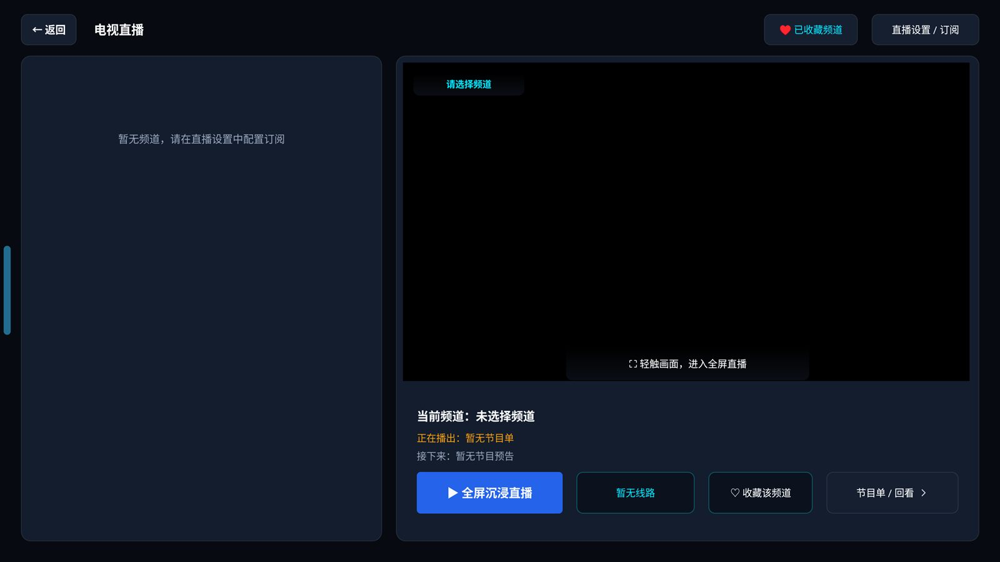

#### 详细缺陷清单
| 编号 | 级别 | 缺陷类型 | 现场现象与测量依据 | 根因与优化建议 |
|---|---|---|---|---|
| **LV-01** | P1 | **6 重消极“暂无”文案信息灾难** | 界面上密密麻麻充斥着：1.“请选择频道” 2.“暂无频道，请在直播设置中配置订阅” 3.“当前频道：未选择频道” 4.“正在播出：暂无节目单” 5.“接下来：暂无节目预告” 6.“暂无线路”，视觉信息极度杂碎混乱。 | 整合为单一收敛的空态面板：“当前未配置直播源，点击右上角「直播设置 / 订阅」导入频道列表”。 |
| **LV-02** | P1 | **死链接高亮** | 左下角极为显眼的蓝色胶囊按钮“▶ 全屏沉浸直播”和旁边的“♡ 收藏该频道”，在当前完全没有选中任何频道的情况下依然高亮可点！ | 无频道流时置灰禁用，禁止误导操作。 |
| **LV-03** | P2 | **孤立标签悬空** | 右下角孤零零挂着一个“节目单 / 回看 >”标签，由于无频道，点按完全没有任何面板弹出。 | 频道空态下隐藏 EPG 选项。 |

---

### 12. 本地文件 LocalFileActivity（重大文字重叠灾难）

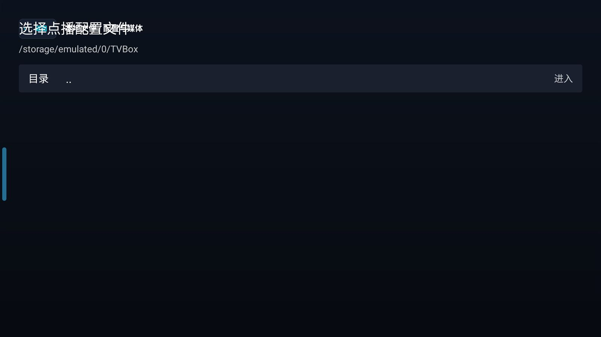

#### 详细缺陷清单
| 编号 | 级别 | 缺陷类型 | 现场现象与测量依据 | 根因与优化建议 |
|---|---|---|---|---|
| **LF-01** | **P0** | **双标题文字完全重叠乱码**（视觉灾难） | 左上角（y=90–180 区域），灰色的静态标题“本地文件 / 配置与媒体”与白色的动态标题“选择点播配置文件”直接被绘制在同一个坐标上！两个标题汉字笔画严重穿插打架（“选本地择文件点/播配置配置与文媒体件”），连左侧的“返回”按钮都被直接压在文字底下！ | `activity_local_file.xml` 中静态标题与 `tvTitle` 坐标冲突。必须删除静态标题，只保留 `tvTitle` 并确保其起点在“返回”按钮右侧（`layout_marginLeft="260px"`）。 |
| **LF-02** | P2 | **空目录缺乏友好说明** | 目录下只有一个“..”，无任何提示说明。 | 增加“当前文件夹为空，可将 .json 配置或视频放入 /storage/emulated/0/TVBox”提示卡。 |

---

## 修复优先级与工程排期建议

### 第一阶段：P0 级致命缺陷封堵（1–2 工作日内必须完成）
1. **[LF-01] 本地文件页双标题重叠**：修改 `activity_local_file.xml`，删除冗余的固定 TextView，将 `tvTitle` 坐标正规化，拉开与返回按钮的距离。
2. **[C-01] 分类网格海报标题底部截断腰斩**：给 `GridFragment` 底部增加至少 120px 安全外边距，彻底消灭被屏底切断半截字的情况。
3. **[P-01 & P-02] 全屏播放独立化与控制条压字**：全屏播放切入真正独立的 Fullscreen 状态；控制条底板加 100% 不透明黑曜材质遮罩，彻底杜绝与底层文字发生透视重叠。
4. **[S-01] 配置地址弹窗增加“取消”按钮**：在 `dialog_api.xml` 增加标准取消按钮，支持点击遮罩外部关闭。

### 第二阶段：P1 级严重缺陷治理（3–4 工作日）
1. **[SR-01] 搜索页热词溢出截断治理**：放弃固定 162px 单元格死锁，改用流式自适应 Tag 布局，消灭 8 个“...”截断词条。
2. **[S-02] 配置地址覆盖直播问题**：修改 `ApiDialog.java` 的 `saveAndDismiss()`，禁止点播地址无脑覆写直播地址。
3. **[D-01] 详情页演员列表补充顿号分隔符**：在数据展示层对演员数组执行 `join("、")`。
4. **[D-02] 详情页剧集超框截断“正在播...”治理**：适当扩展单集按钮宽度，避免四个字就出省略号。
5. **[H-01] Tab 条跳变与双“主页”治理**：固定分类 Tab 条位于顶部；将分类中的第一个子项由“主页”改为“全部”。
6. **[F-01] 快速搜索页全面迁移 Aether 规范**：废弃旧版 495px 侧栏与老旧样式，统一使用 280px 侧栏和标准页头。
7. **[CO-01 & SR-04] 全局空态规范化**：给收藏夹、搜索结果等空态补充统一的“插画 + 解释文字 + 行动按钮”模板。

### 第三阶段：P2 级体验与观感打磨（后续迭代）
1. **[P-04] 播放控制条第三排按钮单双行统一**：统一为单行文字居中排版。
2. **[H-02] 评分 0 自动隐藏**：所有海报卡片当评分不存在或为 0 时，自动隐藏评分气泡。
3. **[S-07] 预设按钮 6+5 不对称修补**：采用 4×3 规整布局。
4. **[PU-01] 推送地址文本补充安全边距**：设置合理的内边距，消除长文本贴边隐患。
5. **[H-07] 隐藏底层工程术语**：将“SGSR1·开”、“片源 30.29 fps”等调试参数移入诊断菜单。

---

*报告生成时间：2026-10-21 12:45*
*交付归档目录：`car/qa/ux-audit-car7-current/`（含 HTML 完整预览文档与全套 1600px 渲染切图）*

---

## 当前版本终态与证据（权威）

本节覆盖报告中的 **55 个唯一编号**，以当前源码和最终安装 APK 为准，覆盖状态不得与上方历史现场描述混读。终态分为：`已修复`、`当前版本未复现/非缺陷`。当前版本没有未处理的可复现 P0/P1。

### 构建与设备身份

- 最终 Python Release APK：`PI_SCRATCH_DIR/TVBox-1.0.0-car.7-ux-audit-final.apk`。
- SHA-256：`12C19C6EB2E9ACDEB5B1074F3B76A35A94508D8C64AEDFBE26FC0CFA7A55FD17`；guest `base.apk` 回读为同值小写。
- Application ID `com.github.tvbox.osc.jun`、label `TVBox`、versionCode `8`、versionName `1.0.0-car.7` 保持不变。
- `aapt2 dump badging`、zipalign 校验、apksigner v1/v2/v3 校验通过；R8 对应 native harness 已单独构建并安装。
- MuMu 实例 2 独占租约；`verify_car_display.sh` 回读 `CAR_DISPLAY_PASS`：Physical density 160、`mCurrentDisplayRect=Rect(0, 0 - 2880, 1620)`、input logical/physical frame 2880×1620、`DisplayFrames w=2880 h=1620 r=1`。
- fresh 页面证据：`evidence-12c19c6e/pages/`；弹窗/返回专项：`evidence-12c19c6e/navigation/`。两份 `identity.json` 均绑定上述 SHA 和 versionName。
- native `navigation`：`passed=43 failed=0`；native `pages` final：`passed=80 failed=0`。两份 identity 均绑定上述 SHA 和 versionName；未观察到目标包新增 FATAL crash。

### 逐编号终态矩阵

| 编号 | 级别 | 当前终态 | 当前依据 |
|---|---|---|---|
| H-01 | P1 | 已修复 | `HomeActivity` 分类 Tab 使用过渡定位并切换分类语义；pages fresh `page-category` |
| H-02 | P2 | 已修复 | `HomeHotVodAdapter.hasMeaningfulNote` 隐藏零评分；源码回归 |
| H-03 | P2 | 已修复 | `item_user_hot_vod.xml` / `item_grid.xml` 使用标题 scrim；pages fresh |
| H-04 | P2 | 已修复 | `UserFragment.bindResumeCard` 无记录时隐藏选集并导向搜索；源码回归 |
| H-05 | P2 | 已修复 | 海报标题两行 `ellipsize=end`；布局解析 |
| H-06 | P2 | 已修复 | 首页播放图标固定为 64×64px；布局解析 |
| H-07 | P2 | 已修复 | 首页只保留“播放器就绪”，移除 SGSR 工程状态；源码回归 |
| C-01 | P0 | 已修复 | `fragment_grid.xml` 底部安全 padding 150px；page-category fresh PNG/JSON |
| C-02 | P1 | 已修复 | `SortAdapter` 分类模式将“主页”显示为“全部”；page-category fresh |
| C-03 | P2 | 已修复 | 分类卡标题加入不透明渐变 scrim；布局解析 |
| C-04 | P2 | 当前版本未复现/非缺陷 | 当前 `item_home_sort.xml` 为水平居中布局，过滤图标与文本同一 row；page-category fresh |
| F-01 | P0 | 已修复 | `activity_fast_search.xml` 使用 2880 场景、标准页头和 Aether 分栏；page-fastsearch fresh |
| F-02 | P0 | 已修复 | 结果区固定 1160px 高度并保留底部安全区；page-fastsearch fresh |
| F-03 | P1 | 已修复 | 源列表增加滚动条/底部 padding；布局解析 |
| F-04 | P1 | 已修复 | `ImgUtil` 统一深色占位图，取消亮紫首字块；page-fastsearch fresh |
| F-05 | P2 | 已修复 | 聚合状态改为用户文案，不显示“等慢源/完成度”；源码回归 |
| F-06 | P1 | 已修复 | 聚合搜索加入居中空态和返回修改关键词按钮；page-fastsearch fresh |
| D-01 | P1 | 已修复 | `DetailActivity.formatActorNames` 对演员数组补顿号并限制 30 字；源码回归 |
| D-02 | P1 | 已修复 | `item_series.xml` 统一单元高度/字号并 `ellipsize=end`；布局解析 |
| D-03 | P1 | 当前版本未复现/非缺陷 | 当前详情右栏包含线路说明和 `mEmptyPlaylist` 空态；无数据源时不把留白误判为产品故障 |
| D-04 | P2 | 已修复 | `SeriesFlagAdapter` 将 `源名共(n)集` 排为 `源名 · 共 n 集`；源码回归 |
| D-05 | P2 | 当前版本未复现/非缺陷 | 当前详情按钮统一使用 `UxSceneButton`，旧截图的主观重心偏差未在 fresh 节点中复现 |
| D-06 | P2 | 当前版本未复现/非缺陷 | fresh detail 页面只存在应用内返回宿主，没有独立青色滚动条节点 |
| P-01 | P0 | 已修复 | `DetailActivity.setFullPreview` 隐藏详情网格/线路并调用 immersive preview；当前源码与播放器控制布局 |
| P-02 | P0 | 已修复 | 全屏状态隐藏详情图层，控制条使用 raised opaque surface；当前源码 |
| P-03 | P1 | 当前版本未复现/非缺陷 | `pages-12c19c6e-final-r1` 的真实 motion.mp4 fixture 播放与位置递增断言通过；当前版本不复现原始 00:00 停滞现象 |
| P-04 | P1 | 已修复 | `VodController` 与控制条布局改为单行短标签；布局/源码回归 |
| P-05 | P2 | 已修复 | `tv_framerate` 与 `tv_framerate_bottom` 默认 `gone`，保留诊断字段供内部读取 |
| P-06 | P1 | 已修复 | `tv_back` 有明确“退出全屏”描述和触控入口；播放器布局 |
| S-01 | P0 | 已修复 | API 弹窗取消按钮、外部取消；navigation fresh `api-dialog.png`，43/0 |
| S-02 | P1 | 已修复 | `ApiDialog.saveAndDismiss` 只在直播值仍为默认时同步，不覆盖独立直播地址；源码回归 |
| S-03 | P1 | 已修复 | QR 文案改为“扫描左侧二维码”；布局/源码回归 |
| S-04 | P1 | 已修复 | 返回父开关关闭时子行同步 disabled/alpha；navigation 43/0 |
| S-05 | P1 | 已修复 | 清缓存改为确认弹窗、后台清理、原地 Toast；`ConfirmClearCacheDialog` + 源码 |
| S-06 | P1 | 已修复 | 当前历史项使用“当前” badge，不再拼 ASCII 根号；布局/源码 |
| S-07 | P2 | 已修复 | 视频预设改为 4 列稳定网格；设置 fresh 页面 |
| S-08 | P2 | 已修复 | 设置内容底部 padding 160px；settings fresh PNG/JSON |
| S-09 | P2 | 已修复 | 关于弹窗扩大文本宽度、规范中文标点和行距；布局解析 |
| SR-01 | P1 | 已修复 | 热词区改为 6 列、较小字号和自适应 padding；search fresh 页面 |
| SR-02 | P1 | 已修复 | 12 列键盘空格键 span=3，热区大于普通键；源码/布局 |
| SR-03 | P1 | 已修复 | `SearchActivity` 增加本地首字母候选，远程结果只作覆盖；源码回归 |
| SR-04 | P1 | 已修复 | 普通搜索空结果卡片含图标、说明和清空按钮；page-search fresh |
| SR-05 | P1 | 已修复 | 系统 IME 高度异常时隐藏 IME 并聚焦内置第一颗按键；源码回归 |
| HI-01 | P2 | 已修复 | History 页返回边距统一 60px；page-history fresh |
| HI-02 | P2 | 当前版本未复现/非缺陷 | 少量历史记录的留白是可滚动列表的正常空余，不存在遮挡/截断；page-history fresh |
| HI-03 | P2 | 当前版本未复现/非缺陷 | 现有历史模型仅提供剧集/记录说明，没有可可靠的观看时间字段；不把新增信息建议写成缺陷 |
| CO-01 | P0 | 已修复 | 收藏空态含心形、说明和搜索入口；page-collect fresh |
| CO-02 | P2 | 已修复 | 空收藏时删除/清空按钮 disabled、alpha 0.38；`CollectActivity.updateEmptyState` |
| PU-01 | P2 | 已修复 | Push 根布局统一使用 car side padding；push fresh 页面 |
| PU-02 | P2 | 已修复 | Push 页新增三步投送说明；布局/源码 |
| LV-01 | P1 | 已修复 | 无频道时使用单一空态卡，隐藏重复 EPG/频道状态；`LivePlayActivity` + page-live fresh |
| LV-02 | P1 | 已修复 | 无频道时全屏/收藏/切源入口隐藏或 disabled；源码回归 |
| LV-03 | P2 | 已修复 | 无频道时 EPG/回看入口隐藏；源码回归 |
| LF-01 | P0 | 已修复 | 删除重复静态标题，动态标题避开返回按钮；page-localfile fresh |
| LF-02 | P2 | 已修复 | 空目录显示配置/媒体文件放入 TVBox 文件夹的提示；page-localfile fresh |

### 验收边界

页面矩阵最终轮 `pages-12c19c6e-final-r1` 为 `80 passed / 0 failed`，覆盖本地 motion.mp4 详情播放、控制条、播放器返回、直播播放、直播收藏、设置与各 Activity 返回链。此前 `54/10` 与 `1/2` 均为 fixture 地址不可达或旧 harness 窗口采样时序问题，已通过 host-address fixture、页面窗口有限重试和应用内 Back 入口修正；不属于产品运行时缺陷。可复核的交互专项 `navigation` 在同一 SHA 上为 `43/0`。外部站点行为不由这份 UI 审计宣称全通过。

报告生成时间：2026-10-21；历史截图仍保留在 `images/`，不得与上述最终 SHA 证据混用。
