# CAR-17.3-3K 第四轮车机 UI 审计完成报告

## 结论

外部 R4 报告中的 **24 条回归项 + 6 条新问题，共 30 条，全部完成复核与修复**；本轮无 P0/P1 遗留。修改没有触碰包名、versionCode、versionName、签名、tag、订阅源或第三方脚本。

- 分支：`feature/car-ux-redesign-3k-fps`
- APK：`TVBox-1.0.0-car.7-r4.apk`
- SHA-256：`97bc08267b17c0b173e6d9332c78f420fbdf6f7fb7d901483482a70a3990beb0`
- 大小：`53,691,860 bytes`
- 包名 / 版本：`com.github.tvbox.osc.jun` / `8` / `1.0.0-car.7`
- 设备：MuMu 实例 1，`2880x1620`，density `160`，`CAR_DISPLAY_PASS`
- 证据：`car/qa/ux-audit-car7-current/evidence-97bc0826/`

## 回归结果（同一 SHA）

| 套件 | 结果 |
|---|---|
| `pages` | 81 passed / 0 failed |
| `ux3k` | 98 passed / 0 failed |
| `playback` | 101 passed / 0 failed |
| `gestures` | 7 passed / 0 failed |
| `states` | 5 passed / 0 failed |

## 页面

### 首页

- 顶栏宽度从 2520 收到 2496，`topLayout` 右边界实测 `2800`，左右不再顶进安全区。
- 「播放器就绪」上移到 `y=1440`，底边 `1496`，正好落在底部安全线。
- 分类胶囊的 item 增加显式激活回调；pager 列表失效时先重建再切换，点击「验收分类2」会立即切换选中态和内容。
- 胶囊行右端不再露出下一个胶囊碎片。

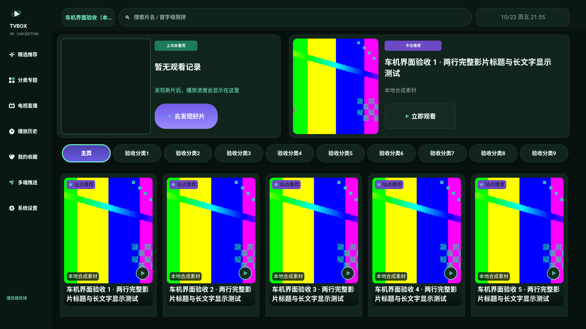

### 详情

- 信息卡高度 386px，和 30px padding、各子项高度精确对齐，简介第 3 行不再被按钮行盖住。
- 右侧「播放源 / 线路」从固定 1400px 改为内容高度，实测 3 集时 `h=565`、底边 725，不再越界，也不再留下 90% 空白。
- 返回按钮左边距 80px；删除右上角无功能的 `TVBOX 3K` 徽标。
- 剧集格统一单行集号，选中态只靠底色和文字色区分。
- 预览提示移到画面底部，不再与居中 spinner 叠字。

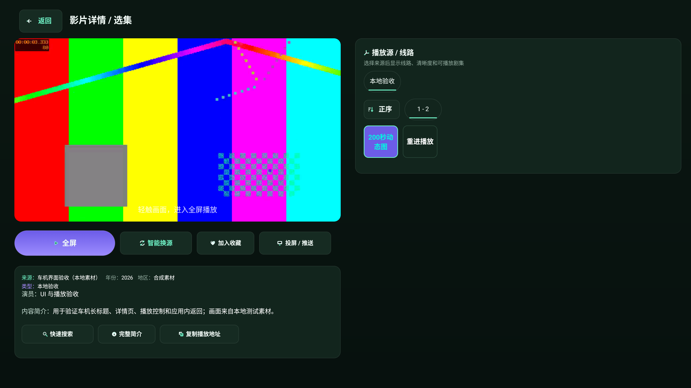

### 搜索

- 搜索按钮改为图标在左、文字在右，整组水平居中。
- 热词限制 15 个、5 列 3 行，单格 84px，不再截断第 18 个词。
- 搜索空态不再残留「多源搜索结果」标题；idle 状态只保留输入引导。
- 78 站点搜索源弹窗：全选/全不选改为 190×68 的小按钮；列表独立滚动；底部固定「关闭」。滚动到底后 `车机站点 78` 完整显示在底栏上方。

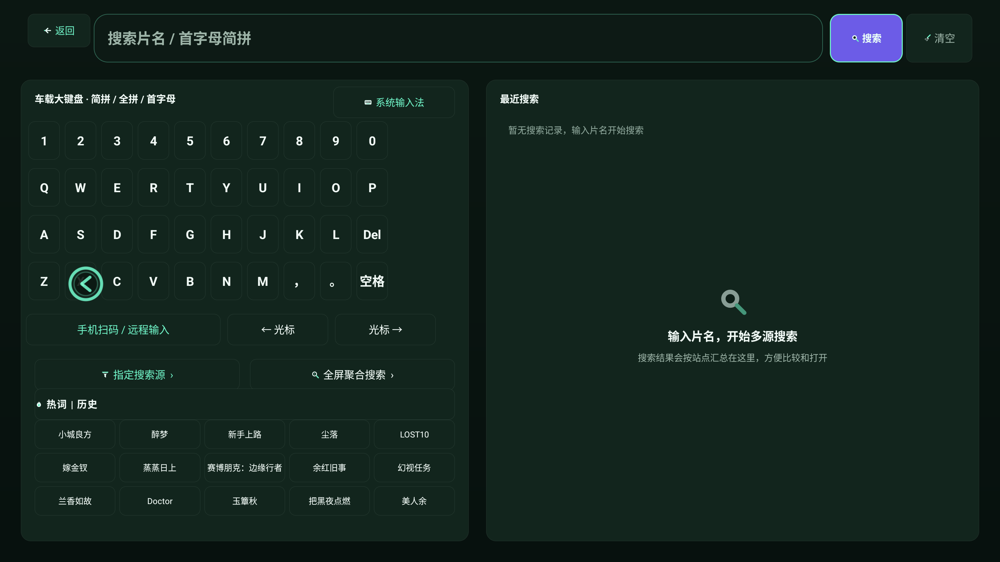

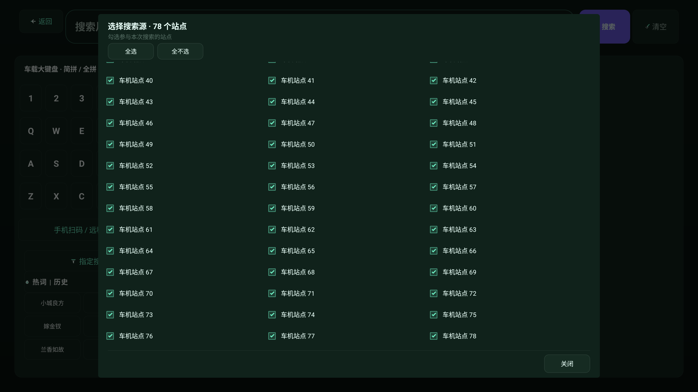

### 直播

- 未配置直播源时隐藏左侧空频道卡和右侧预览卡，空态整页铺满，去掉外层黑边。
- 空态说明改为「导入直播源后，频道列表和节目单会显示在这里」，并保留「打开直播设置 / 订阅」入口。

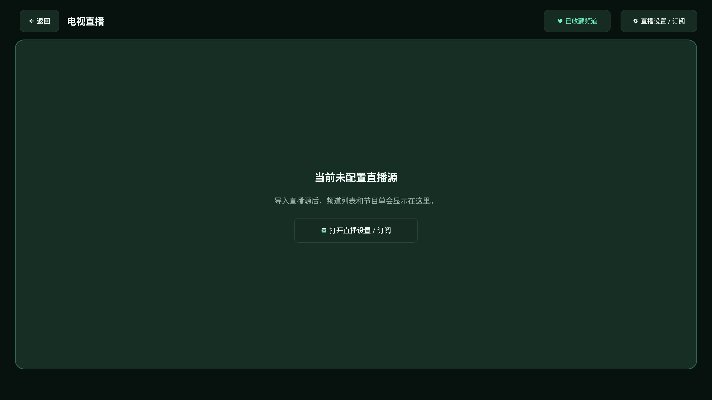

### 设置

- 设置行高度 104px，底部加分隔线，值列改为薄荷色并固定在标签右侧，不再横跨 1200px。
- 滚动条常显，内容底部保留 160px 安全内边距。
- 「画面处理链」从两个 930×150 空框改成三个 80px 节点（原始输入 → GL 增强 → 屏幕输出），卡片高度 330→200。

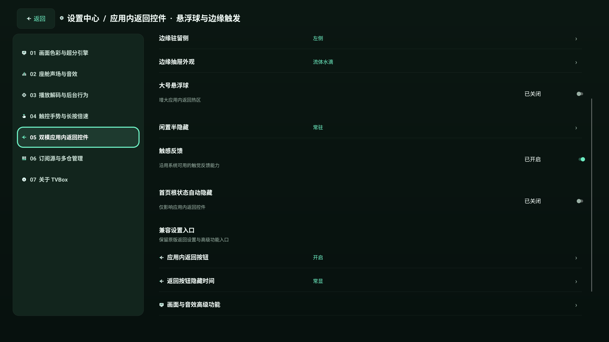

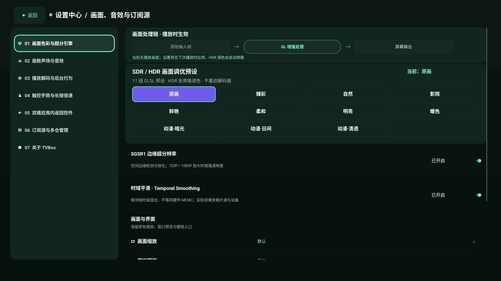

### 收藏 / 历史

- 清空/清理从纯图标改成 220×90 图标+文字按钮，图标盒统一。
- 历史标题区最小高度 120px，使用 120px 底部渐变遮罩，两行标题不再贴卡片底边。
- 有显式返回控件的页面隐藏左侧静止边缘把手，边缘返回手势仍然可用；首页保留把手。

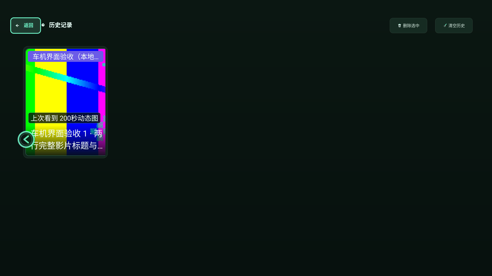

### 推送

- 改为左右分栏：左侧二维码卡片 + 地址，右侧主标题、说明、三个编号步骤、次级「推送剪贴板内容」按钮和局域网说明。
- 二维码改为 260dp 圆角浅色卡片，不再是纯白直角块。
- 「推送剪贴板内容」改用 `UxSecondaryAction`，不再使用脱离体系的灰色底。

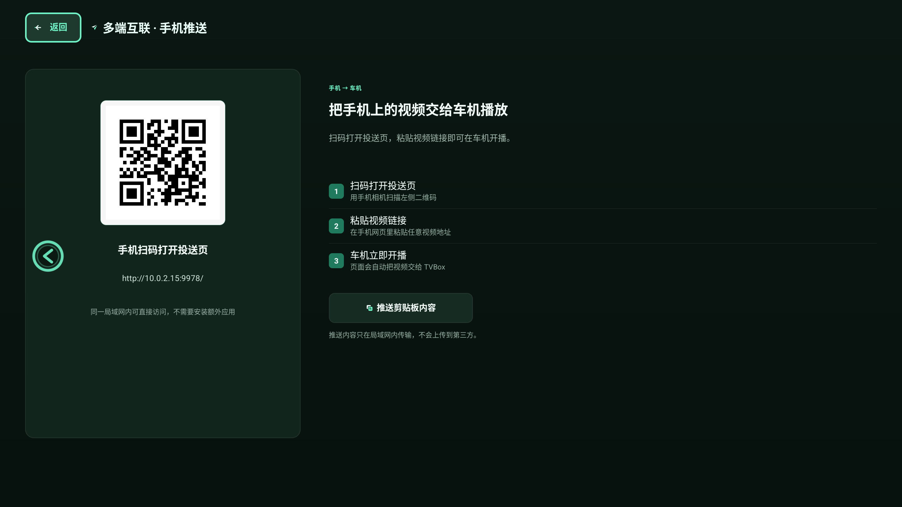

### 数据源弹窗

- `ApiDialog` 输入框获焦时整体上移到 `y=40`；取消/确定 bounds `y=780..860`，低于输入法起始 `y≈982`，不会再被键盘遮住。
- 二维码加 18px 圆角和 14px 内边距；输入框改为填充式 `car_input_surface`，边界和焦点态清楚。
- 源列表 `SelectDialog` 增加固定底部「关闭」和 18px 底距，最后一行不再贴底。

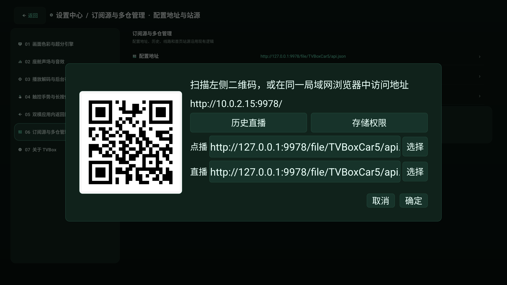

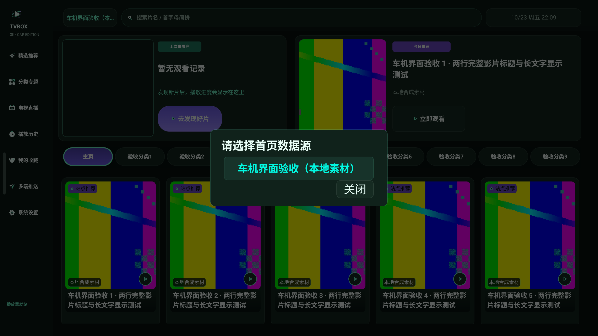

### 播放器

全屏主控仍保持「上一集 / 后退 15 秒 / 播放暂停 / 前进 15 秒 / 下一集 / 选集 / 更多」；隐藏控制层仍保留左上返回入口；播放信息关闭时同步隐藏时间/网速与分辨率/帧率技术层。`playback` 101/0。

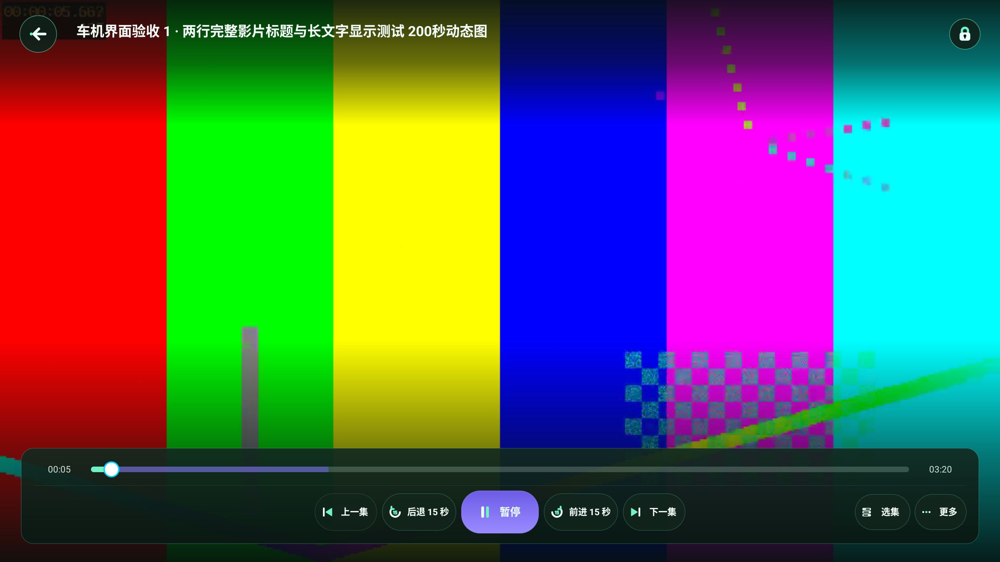

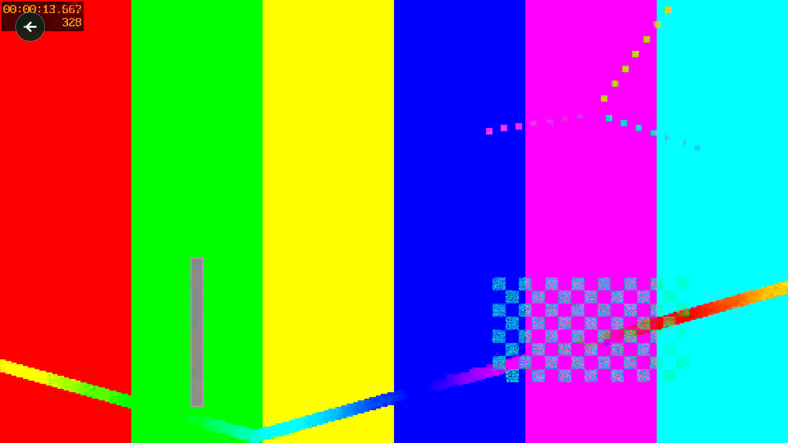

## R4 逐项状态

| 编号 | 状态 |
|---|---|
| X01 / D01 信息卡溢出 | 已修 |
| X02 / D02 预览提示叠字 | 已修 |
| X03 / D03 剧集格行数不一 | 已修 |
| X04 / D04 右面板固定 1400px | 已修 |
| X05 / D05 返回边距与占位徽标 | 已修 |
| X06 / H01 顶栏右侧越界 | 已修 |
| X07 / H02 播放器状态越底边 | 已修 |
| X08 / S03 搜索按钮图标压字 | 已修 |
| X09 / S02 热词末格截断 | 已修 |
| X10 / C01 六页左侧竖条 | 已修 |
| X11 / C02 清空仅图标 | 已修 |
| X12 / L01 直播空态左卡与黑边 | 已修 |
| X13 / G01 设置行距离与分隔 | 已修 |
| X14 / G02 设置末行裁切 | 已修 |
| X15 / G03 处理链空框 | 已修 |
| X16 / P01 输入法遮挡 | 已修 |
| X17 / P02 二维码与输入框 | 已修 |
| X18 / P03 源列表关闭按钮 | 已修 |
| N01 顶部分类胶囊无响应 | 已修 |
| N02 搜索空态残留标题 | 已修 |
| N03 历史标题无渐变遮罩 | 已修 |
| N04 78 站点弹窗 | 已修 |
| N05 推送页层级 | 已修 |
| N06 胶囊行右端残片 | 已修 |

## 设计边界与说明

- 保留所有真实能力：返回、边缘手势、悬浮返回球、音效、字幕、选集、换源、后台恢复、播放器控制层。
- 没有新增组件库依赖；`CarIconTextView` 只解决「图标 + 文字」整组居中，并保留 XML 原始 padding 作为重新居中的基准。
- `P01` 的 MuMu 环境使用硬件键盘模式，系统输入法窗口没有可用 surface，所以截图里只有上移后的弹窗；用 `uiautomator` 的 bounds 验证了取消/确定位于 IME 起始线之上。
- 所有页面截图均为 2880×1620 原生 Android 截图；背景彩条是本地验收视频。
- 空/加载/错误/离线截图由真实 Android 状态组件强制展示，不是网络事件录像。
- 测试 APK 与原 APK 使用同一测试证书；设备端 `base.apk` SHA 与报告 SHA 一致。
